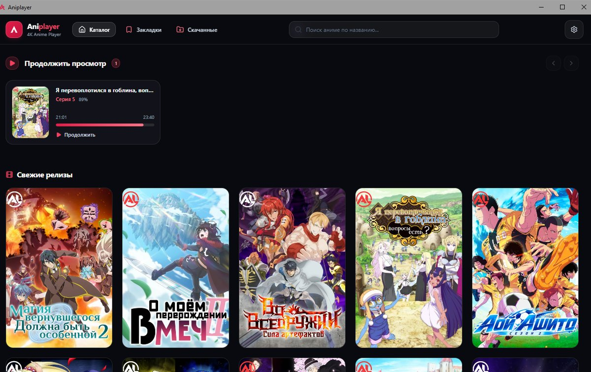
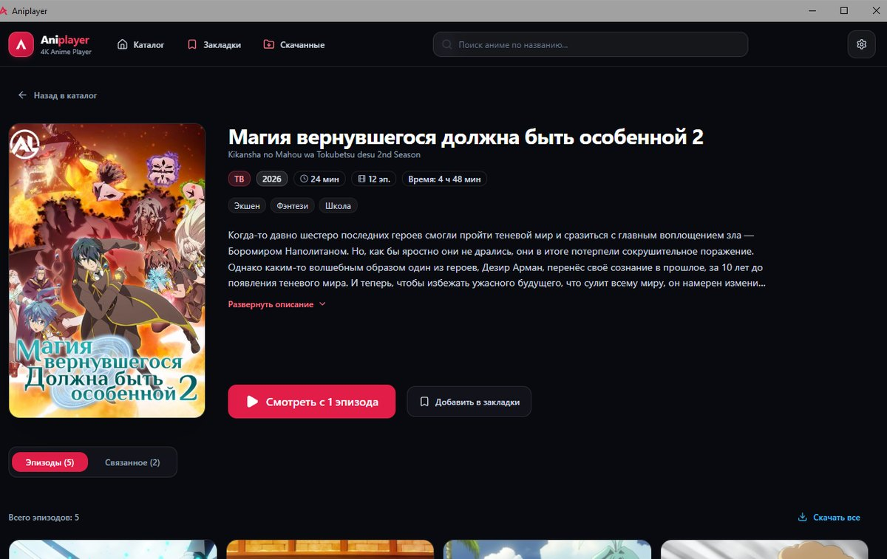
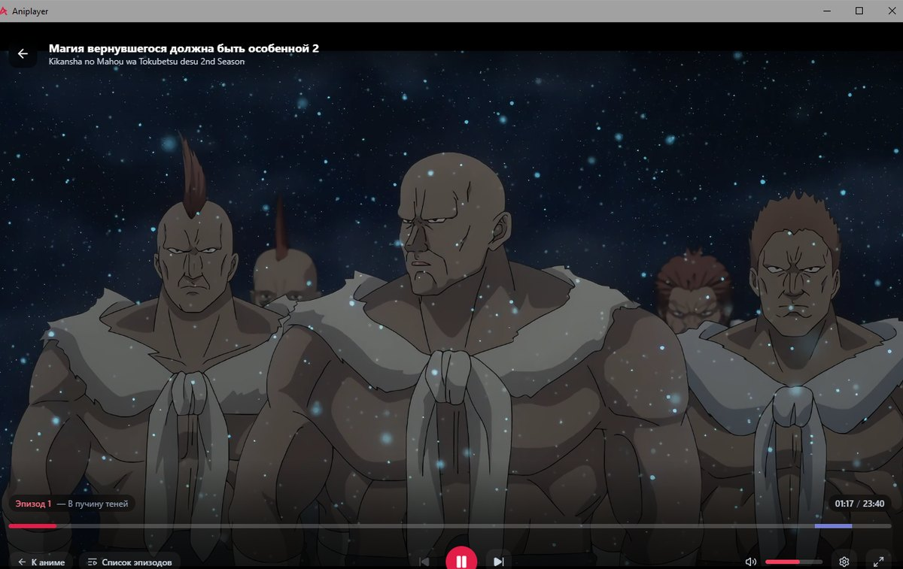
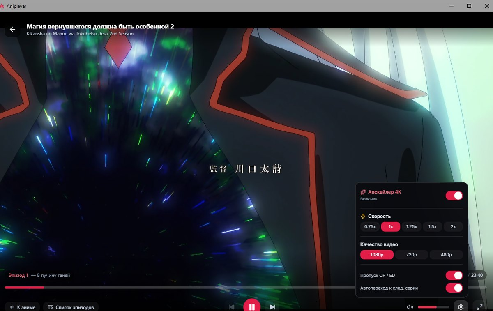
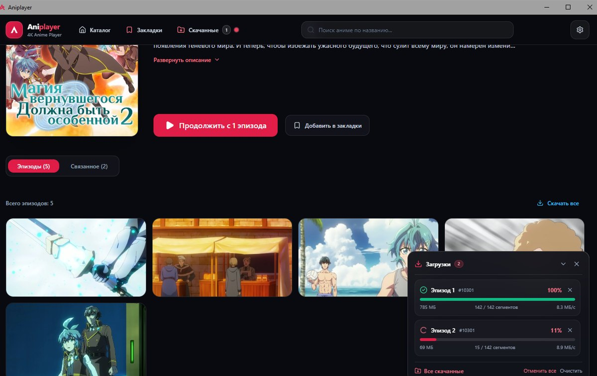
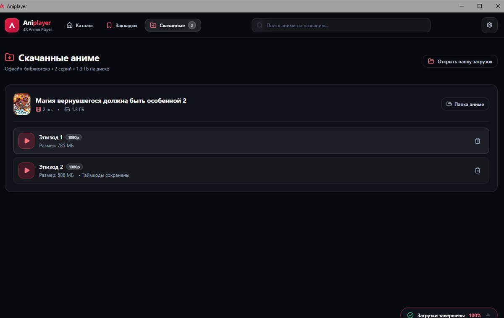
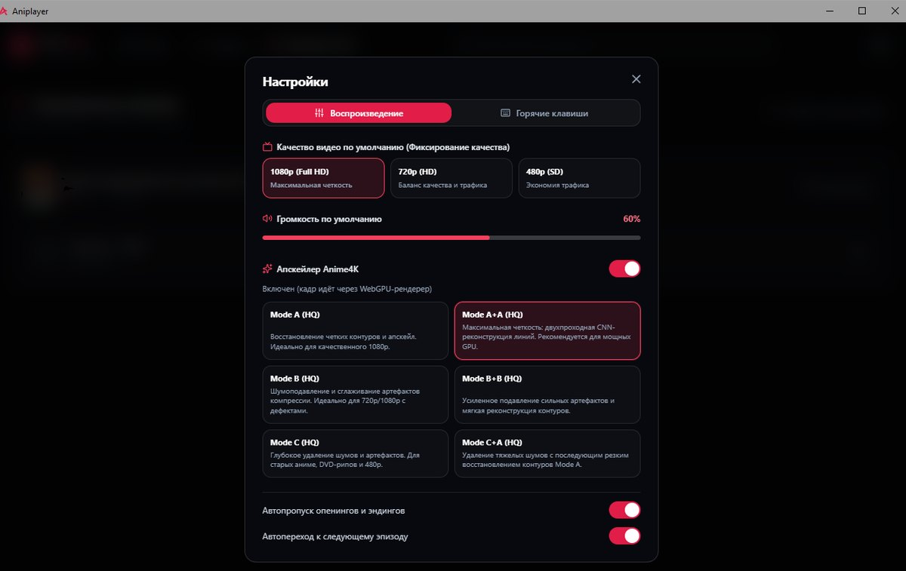

# Aniplayer

Десктопный плеер для аниме из каталога [AniLiberty](https://aniliberty.top) для Windows 10 и 11:
онлайн-воспроизведение в 480p/720p/1080p, скачивание серий на диск, апскейл Anime4K, продолжение
просмотра, автопропуск опенинга и эндинга, автопереход к следующей серии. Ни торрентов, ни рекламы,
ни аккаунта — установил и смотришь.

[](https://github.com/shidot3m/aniplayer/releases/tag/latest)
[](docs/development.md#требования-к-окружению)
[](LICENSE)



## Возможности

<table>
  <tr>
    <td></td>
    <td><b>Каталог AniLiberty</b> — свежие релизы, расписание, жанры, франшизы и поиск по названию. На странице релиза: описание, жанры, список серий и связанные сезоны.</td>
  </tr>
  <tr>
    <td></td>
    <td><b>Плеер в том же окне</b> — без второго окна и без внешних проигрывателей. Прогресс-бар, громкость, скорость 0.75×–2×, полный экран, переход между сериями.</td>
  </tr>
  <tr>
    <td></td>
    <td><b>Качество на лету</b> — 480p / 720p / 1080p переключаются посреди серии, позиция и пауза сохраняются. Там же — апскейл Anime4K, скорость и автопропуск заставки.</td>
  </tr>
  <tr>
    <td></td>
    <td><b>Скачивание серий</b> — одна серия или весь релиз, плавающий виджет прогресса с байтами и скоростью, отмена одной загрузки или всех сразу.</td>
  </tr>
  <tr>
    <td></td>
    <td><b>Офлайн-библиотека</b> — все скачанные серии в одном месте, с размером на диске и сохранёнными таймкодами. Играются без подключения к сети.</td>
  </tr>
  <tr>
    <td></td>
    <td><b>Настройки</b> — качество по умолчанию, громкость, шесть пресетов Anime4K и назначаемые горячие клавиши.</td>
  </tr>
</table>

- **Продолжение просмотра.** Незаконченная серия возвращается на карточке «Продолжить просмотр» с того же места.
- **Автопропуск заставки и титров** и **автопереход к следующей серии** — оба тумблера в меню плеера и в настройках.
- **Anime4K через WebGPU.** Кадр серии проходит через WebGPU-рендерер: шесть пресетов (Mode A, A+A, B, B+B, C, C+A) применяются прямо во время воспроизведения. Нужен WebGPU в WebView2 — без него тумблер отключён с объяснением причины, остальное работает как обычно.
- **Закладки и история** — локально, в SQLite рядом с программой.
- **Ретраи против CDN.** Если сегмент не отвечает, плеер не замирает: короткая пауза, шаг через дырку в буфере, продолжение просмотра. Контролы остаются живыми, перезапуск сессии не нужен.

Субтитров в плеере нет: ни один плейлист каталога не несёт текстовую дорожку, а в hardsub-релизах
надписи уже в кадре. Замер и триггер пересмотра — в [ADR 0017](docs/adr/0017-no-subtitle-control-the-catalog-delivers-no-text-track.md).

## Сборка из исходников

```bash
bun install
bun run tauri:win build     # aniplayer.exe + NSIS-установщик
```

Полный набор требований, запуск дев-окружения, тесты, линт и конвейер релизов описаны
в [docs/development.md](docs/development.md). Устройство кода — в
[docs/architecture.md](docs/architecture.md), термины — в [GLOSSARY.md](GLOSSARY.md), принятые
решения — в [docs/adr/](docs/adr/).

## Лицензия и ответственность

Aniplayer распространяется под **GNU GPL v3** ([LICENSE](LICENSE)).

Программа — это плеер и клиент публичного API. Она ничего не хранит на своих серверах, ничего не
раздаёт другим пользователям и не контролирует содержимое каталога AniLiberty: ссылки на
воспроизведение и скачивание отдаёт этот сервис. Оценку законности просмотра и скачивания
в вашей юрисдикции вы несёте сами; претензии по контенту — к владельцам каталога.
