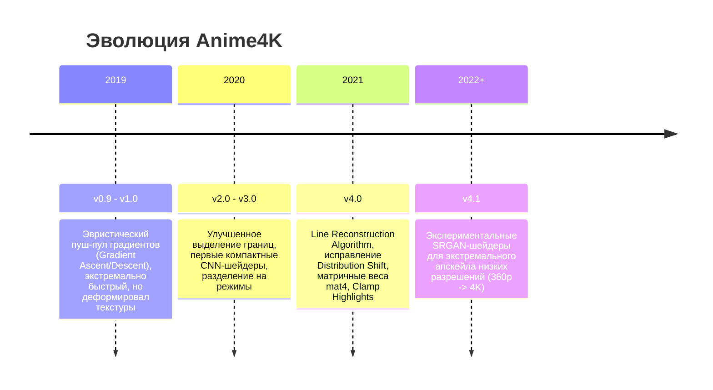
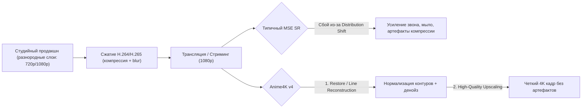
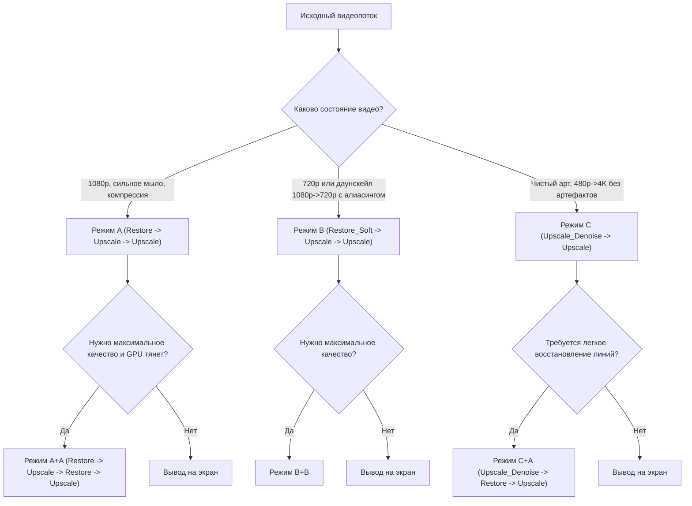
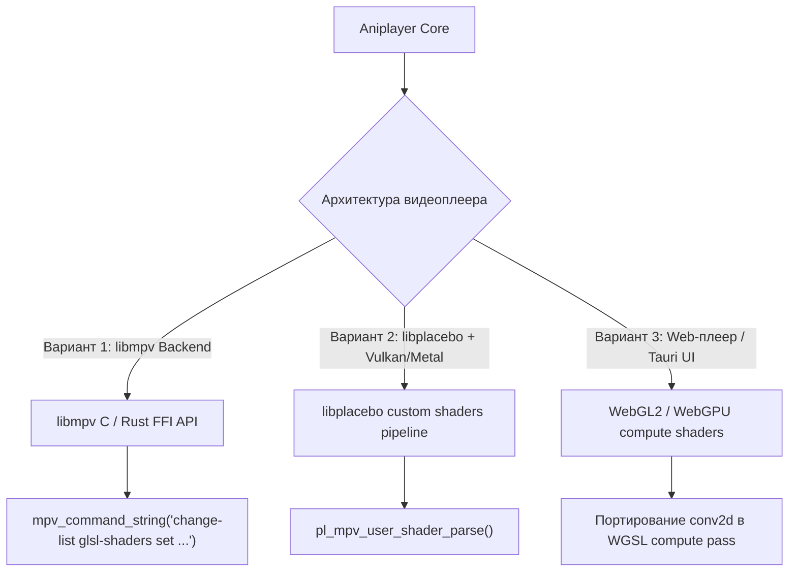

# Anime4K: Архитектура, алгоритмы и руководство по интеграции

> Полное руководство по набору алгоритмов масштабирования и восстановления аниме в реальном времени **[Anime4K](https://github.com/bloc97/Anime4K)** (автор: Anthony Nguyen / bloc97), их математическим основам, устройству шейдеров GLSL и интеграции в видеоплеер **Aniplayer**.

> [!NOTE]
> **Статус в этом проекте (2026-11-04).** Бэкендом воспроизведения стал сам webview — `<video>` + hls.js ([ADR 0014](adr/0014-webview-is-the-only-playback-backend.md)), — поэтому подпроцесс mpv и каталог `shaders/anime4k/` выведены из дерева. Апскейл вернулся как собственный WebGPU-рендерер поверх медиаэлемента: кадр берётся `requestVideoFrameCallback`-ом, прогоняется через конвейер `anime4k-webgpu` и показывается canvas-оверлеем ([ADR 0015](adr/0015-anime4k-as-a-webgpu-renderer.md), [#61](https://github.com/shidot3m/aniplayer/issues/61)). Пресеты — ровно шесть конвейеров, которые пакет действительно экспортирует (Mode A, A+A, B, B+B, C, C+A); «Mode Fast (APU)» — имя, которого в пакете никогда не было, удалено из Settings и из GLOSSARY. Разделы про формат шейдеров MPV/libplacebo, диагностику в mpv и `mpv.conf` остаются справочным материалом об upstream-формате Anime4K и больше не описывают код Aniplayer.

---

## Содержание

1. [Введение и философия проекта](#1-введение-и-философия-проекта)
   - [Проблема перекодирования в 4K](#проблема-перекодирования-в-4k)
   - [Сравнение с waifu2x, Real-ESRGAN и FSRCNNX](#сравнение-с-waifu2x-real-esrgan-и-fsrcnnx)
   - [Эволюция версий (v1.0 → v4.x / v4.1)](#эволюция-версий-v10--v4x--v41)
2. [Теоретические и математические основы](#2-теоретические-и-математические-основы)
   - [Проблема сдвига распределения (Distribution Shift) в 1080p аниме](#проблема-сдвига-распределения-distribution-shift-в-1080p-аниме)
   - [Алгоритм реконструкции контурных линий (Line Reconstruction)](#алгоритм-реконструкции-контурных-линий-line-reconstruction)
   - [Свёрточные нейронные сети (CNN) и оптимизация весов](#свёрточные-нейронные-сети-cnn-и-оптимизация-весов)
   - [Сепарабельные фильтры разности гауссиан (Difference of Gaussians, DoG)](#сепарабельные-фильтры-разности-гауссиан-difference-of-gaussians-dog)
   - [Билатеральная фильтрация (Bilateral Mean / Median / Mode)](#билатеральная-фильтрация-bilateral-mean--median--mode)
   - [Защита от овершута и звона (Clamp Highlights)](#защита-от-овершута-и-звона-clamp-highlights)
   - [Умное предмасштабирование (AutoDownscalePre)](#умное-предмасштабирование-autodownscalepre)
3. [Каталог и классификация шейдеров](#3-каталог-и-классификация-шейдеров)
   - [Категории шейдеров](#категории-шейдеров)
   - [Градация по производительности (S, M, L, VL, UL, UUL)](#градация-по-производительности-s-m-l-vl-ul-uul)
4. [Основные режимы работы (Modes A, B, C)](#4-основные-режимы-работы-modes-a-b-c)
   - [Режим A (Mode A / A+A)](#режим-a-mode-a--aa)
   - [Режим B (Mode B / B+B)](#режим-b-mode-b--bb)
   - [Режим C (Mode C / C+A)](#режим-c-mode-c--ca)
   - [Сводная матрица выбора режима](#сводная-матрица-выбора-режима)
5. [Производительность и бюджет времени кадра](#5-производительность-и-бюджет-времени-кадра)
   - [Бюджет кадровой развертки (24, 30, 60 FPS)](#бюджет-кадровой-развертки-24-30-60-fps)
   - [Градация GPU и ресурсоёмкость шейдеров](#градация-gpu-и-ресурсоёмкость-шейдеров)
   - [Диагностика и профилирование в MPV](#диагностика-и-профилирование-в-mpv)
6. [Формат шейдеров MPV / libplacebo](#6-формат-шейдеров-mpv--libplacebo)
   - [Директивы препроцессора (HOOK, BIND, SAVE, WHEN, WIDTH, HEIGHT)](#директивы-препроцессора-hook-bind-save-when-width-height)
   - [RPN-выражения для условного выполнения](#rpn-выражения-для-условного-выполнения)
7. [Интеграция в видеоплееры](#7-интеграция-в-видеоплееры)
   - [Настройка MPV (mpv.conf, input.conf)](#настройка-mpv-mpvconf-inputconf)
   - [Интеграция в архитектуру Aniplayer](#интеграция-в-архитектуру-aniplayer)
8. [Обучение моделей и генерация шейдеров](#8-обучение-моделей-и-генерация-шейдеров)

---

## 1. Введение и философия проекта

**Anime4K** — открытый набор высокоэффективных алгоритмов восстановления и сверхвысокого разрешения (Super-Resolution, SR) в реальном времени, ориентированных специально на анимационную 2D-графику. Разработан канадским исследователем Энтони Нгуеном ([bloc97](https://github.com/bloc97)).

### Проблема перекодирования в 4K

Классический подход к улучшению разрешения видео — офлайн-апскейл (например, через Topaz Video AI или офлайн waifu2x) с последующим перекодированием в файл 4K. Создатели Anime4K обосновывают порочность этой практики:

1. **Необратимость (Non-reversible):** постоянное искажение оригинала артефактами галлюцинаций нейросети.
2. **Квадратичный рост объёма (до $O(N^2)$):** хранение 4K-видеопотока требует огромных дисковых пространств и полосы пропускания.
3. **Отсутствие прироста энтропии:** если информация в исходнике отсутствовала, её физически нет в сжатом файле. Добавление искусственных бит при пережатии не увеличивает энтропию исходного медиа.
4. **Апскейлинг на лету (Real-Time Client-Side):** Anime4K выполняется непосредственно на GPU зрителя во время воспроизведения, гарантируя бережное отношение к оригинальному контенту и нулевые требования к серверному хранению дубликатов в 4K.

### Сравнение с waifu2x, Real-ESRGAN и FSRCNNX

| Алгоритм              | Класс                                    | Скорость на кадр (1080p) | Работа в реальном времени (24–60 FPS) | Особенности                                                                                               |
| --------------------- | ---------------------------------------- | ------------------------ | ------------------------------------- | --------------------------------------------------------------------------------------------------------- |
| **Bicubic / Lanczos** | Классическая интерполяция                | $< 1$ мс                 | Да (любой GPU/CPU)                    | Сильное замыливание, звон на контрастных линиях                                                           |
| **FSRCNNX**           | Свёрточная сеть общего назначения        | $5 - 15$ мс              | Да (на дискретных GPU)                | Обучен на фото, не учитывает специфику линий аниме                                                        |
| **Anime4K v4.x**      | Гибрид (CNN + Line Reconstruction + DoG) | $2 - 18$ мс              | **Да (даже на слабых GPU и APU)**     | Специализирован на контурах аниме, устранении дефектов композитинга и компрессии                          |
| **waifu2x**           | Глубокая сверточная сеть (SRCNN)         | $150 - 500$ мс           | **Нет** (только покадровый офлайн)    | Отличное качество на статике, непригоден для видео 24+ fps                                                |
| **Real-ESRGAN**       | GAN (Generative Adversarial Network)     | $500 - 3000$ мс          | **Нет** (очень тяжелый)               | Высокая детализация текстур, но генерирует временные мерцания (temporal instability) и требует мощных GPU |

### Эволюция версий (v1.0 → v4.x / v4.1)



- **v1.x:** Базировался исключительно на геометрических фильтрах (нахождении нормалей линий и «стягивании» пикселей к центру линии). Работал мгновенно, но сглаживал тонкие градиенты и мелкие текстуры.
- **v2.x — v3.x:** Переход к гибридной схеме с первыми сверточными моделями.
- **v4.x (текущий стабильный стандарт):** Комплексная конвейерная система с предварительным восстановлением (`Restore`), подавлением звона (`Clamp_Highlights`), раздельным апскейлом контуров и текстур, и калибровкой под различные типы деградации источника.
- **v4.1:** Добавление экспериментальных легковесных GAN-сетей (`Anime4K_Upscale_GAN_x*`) для контента с экстремально низким исходным разрешением ($360p \to 4K$).

---

## 2. Теоретические и математические основы

### Проблема сдвига распределения (Distribution Shift) в 1080p аниме

Большинство классических алгоритмов супер-разрешения обучаются на синтетических датасетах: берется четкое изображение в 4K, уменьшается бикубической фильтрацией до 1080p, после чего сеть обучается восстанавливать 4K с минимизацией среднеквадратичной ошибки (MSE/L1).

Однако в реальном производстве аниме ("in the wild") цепочка совершенно иная:
1. Аниматоры рисуют контуры на планшетах или сканируют бумагу в различных разрешениях.
2. Проводится цифровой композитинг персонажей, спецэффектов и 3D-задников в разном масштабе (часто задники рендерятся в $720p$, спецэффекты в $540p$, персонажи в $1080p$).
3. Студия сжимает мастер-ленту с использованием сглаживающих фильтров для борьбы с алиасингом, после чего видео кодируется с потерями в H.264 / H.265.
4. В результате контуры страдают от **комбинации размытия, звона (ringing), лестничного эффекта (aliasing) и блочности компрессии**.

Это вызывает так называемый **сдвиг распределения (Distribution Shift)**: синтетически обученные модели дают сбой, размывая контуры или усиливая артефакты сжатия.



### Алгоритм реконструкции контурных линий (Line Reconstruction)

Вместо того чтобы надеяться, что нейросеть «догадается» об идеальной форме линии через MSE-лосс, Anime4K декомпозирует задачу:
1. Оценивается локальное направление градиента яркости ($\nabla I = (\frac{\partial I}{\partial x}, \frac{\partial I}{\partial y})$).
2. Вычисляется профиль контура перпендикулярно его касательной.
3. Нейросетевой блок восстанавливает резкий пик интенсивности контура, компенсируя расплывание и смазывание от компрессии.
4. Предотвращается галлюцинирование несуществующих деталей: алгоритм восстанавливает геометрию имеющихся контуров, а не выдумывает текстуры.

### Свёрточные нейронные сети (CNN) и оптимизация весов

Для достижения скорости в $100+$ FPS на мобильных и дискретных GPU шейдеры Anime4K используют сверхкомпактные CNN:
- Глубина сетей: $3 - 8$ слоев.
- Размер свёрточных ядер: $3 \times 3$ пикселя.
- Ограничение каналов: от 4 до 16 каналов на скрытый слой.
- **Инлайн-матрицы в GLSL:** Все веса сверток запечены прямо в код шейдера в виде аппаратных типов `mat4` (матрицы $4 \times 4$).

Пример фрагмента сгенерированного шейдера свёртки:
```glsl
// Anime4K Restore CNN Conv Pass
#define go_0(x_off, y_off) (MAIN_texOff(vec2(x_off, y_off)))

vec4 hook() {
    vec4 result = mat4(-0.0999,  0.1378, -0.0312, -0.0635,
                       -0.3437,  0.0545,  0.3434,  0.4633,
                        0.0860,  0.0121, -0.1567,  0.2891,
                       -0.2104, -0.1192,  0.0456, -0.0782) * go_0(-1, -1)
                + mat4(...) * go_0( 0, -1)
                + ... ;
    return max(result, vec4(0.0)); // ReLU активация
}
```
Благодаря использованию `mat4` компилятор драйвера GPU транслирует такие умножения в векторные SIMD/FMA-инструкции графического процессора за один такт.

### Сепарабельные фильтры разности гауссиан (Difference of Gaussians, DoG)

Для не-нейросетевого деблюра и резкости контуров в реальном времени применяется фильтр Difference of Gaussians:
$$DoG(x, y) = G_{\sigma_1}(x, y) - G_{\sigma_2}(x, y)$$
где $G_\sigma$ — двумерная функция Гаусса с дисперсией $\sigma_1 < \sigma_2$.

Вычисление разделяется на два одномерных прохода (по горизонтали $X$, затем по вертикали $Y$), что снижает вычислительную сложность с $O(K^2)$ до $O(2K)$ операций на пиксель.

### Билатеральная фильтрация (Bilateral Mean / Median / Mode)

Для удаления блочного шума и шума квантования без потери резкости границ используются билатеральные шейдеры:
- **Bilateral Mean:** Усреднение соседей с весом, зависящим как от пространственного расстояния, так и от разницы в яркости:
  $$I_{out}(p) = \frac{1}{W_p} \sum_{q \in \Omega} I(q) \, f_s(\|p - q\|) \, f_r(|I(p) - I(q)|)$$
- **Bilateral Median:** Медианное значение в локальном окне с адаптивной яркостной маской. Идеально для удаления «соли и перца» и изолированных пикселей шума компрессии.
- **Bilateral Mode:** Поиск моды распределения яркостей. Создает характерный чистый мультипликационный эффект с ровными плашками заливки.

### Защита от овершута и звона (Clamp Highlights)

При агрессивном восстановлении контуров или двукратном апскейле часто возникает неприятный артефакт — белый «ореол» вокруг черных линий (ringing / overshoot).

Шейдер `Anime4K_Clamp_Highlights.glsl` решает эту проблему элегантным двухстадийным алгоритмом:
1. **Сбор статистики (MAIN stage):** В начале конвейера вычисляется локальный максимум яркости в окрестности $5 \times 5$:

   ```glsl
   float current_luma = dot(vec4(0.299, 0.587, 0.114, 0.0), rgba);
   // Раздельный проход 1D Max по X, затем 1D Max по Y
   ```
2. **Ограничение выбросов (PREKERNEL stage):** После выполнения всех восстанавливающих шейдеров итоговая яркость пикселя ограничивается сохраненным исходным максимумом:

   ```glsl
   float new_luma = min(current_luma, STATSMAX_tex(HOOKED_pos).x);
   return HOOKED_tex(HOOKED_pos) - (current_luma - new_luma);
   ```
Это предотвращает появление паразитных белых кайм и звона вокруг контрастных деталей.

### Умное предмасштабирование (AutoDownscalePre)

При апскейле $1080p \to 4K$ коэффициент масштабирования составляет $2\times$ ($1920 \times 1080 \to 3840 \times 2160$).
Однако для промежуточных разрешений экранов (например, $1440p$ — $2560 \times 1440$, коэффициент $1.33\times$) запуск двух шейдеров $2\times$ увеличил бы текстуру до $4K$, заставив видеокарту обрабатывать в $4$ раза больше пикселей на последующих этапах, чтобы потом просто отмасштабировать результат вниз до $1440p$.

Шейдеры `AutoDownscalePre_x2.glsl` и `AutoDownscalePre_x4.glsl` содержат директиву с условием в обратной польской нотации (RPN):
```glsl
//!WHEN OUTPUT.w NATIVE.w / 2.0 < OUTPUT.h NATIVE.h / 2.0 < * OUTPUT.w NATIVE.w / 1.2 > OUTPUT.h NATIVE.h / 1.2 > * *
//!WIDTH OUTPUT.w
//!HEIGHT OUTPUT.h
```
Если окно плеера меньше двойного размера оригинала, шейдер немедленно интерполирует кадр ровно под размер целевого экрана, экономя до 60–75% вычислительного времени видеокарты!

---

## 3. Каталог и классификация шейдеров

### Категории шейдеров

| Каталог                  | Назначение                                                                             | Примеры файлов                                                                                              |
| ------------------------ | -------------------------------------------------------------------------------------- | ----------------------------------------------------------------------------------------------------------- |
| **Restore**              | Восстановление размытых контуров, удаление компрессионных артефактов и звона           | `Anime4K_Restore_CNN_M.glsl`<br/>`Anime4K_Restore_CNN_Soft_VL.glsl`<br/>`Anime4K_Clamp_Highlights.glsl`     |
| **Upscale**              | Увеличение пространственного разрешения в $2\times$ для чистых текстур                 | `Anime4K_Upscale_CNN_x2_M.glsl`<br/>`Anime4K_Upscale_CNN_x2_VL.glsl`<br/>`Anime4K_AutoDownscalePre_x2.glsl` |
| **Upscale+Denoise**      | Совмещенный апскейл $2\times$ с подавлением шума без дополнительных накладных расходов | `Anime4K_Upscale_Denoise_CNN_x2_M.glsl`<br/>`Anime4K_Upscale_Denoise_CNN_x2_VL.glsl`                        |
| **Denoise**              | Билатеральное шумоподавление на исходном разрешении                                    | `Anime4K_Denoise_Bilateral_Mean.glsl`<br/>`Anime4K_Denoise_Bilateral_Median.glsl`                           |
| **Deblur**               | Повышение резкости контуров на основе DoG без овершута                                 | `Anime4K_Deblur_DoG.glsl`<br/>`Anime4K_Deblur_Original.glsl`                                                |
| **Experimental-Effects** | Стилизация контуров: утончение (Thin) или затемнение (Darken)                          | `Anime4K_Thin_HQ.glsl`<br/>`Anime4K_Darken_HQ.glsl`                                                         |

### Градация по производительности (S, M, L, VL, UL, UUL)

Каждый нейросетевой шейдер представлен в нескольких весовых категориях:

| Суффикс | Полное название         | Относительное время выполнения             | Рекомендуемый класс GPU                                       |
| ------- | ----------------------- | ------------------------------------------ | ------------------------------------------------------------- |
| **S**   | Small                   | $1.0\times$ (база, $\approx 0.5 - 1.5$ мс) | Интегрированная графика (Intel Iris Xe, AMD Vega 7/RDNA2 APU) |
| **M**   | Medium                  | $2.0\times$ ($\approx 1.5 - 3.0$ мс)       | Бюджетные дискретные GPU (GTX 1050Ti / GTX 1650 / RX 560)     |
| **L**   | Large                   | $4.0\times$ ($\approx 3.0 - 6.0$ мс)       | Средний класс (GTX 1060 / RTX 2060 / RX 580)                  |
| **VL**  | Very Large              | $8.0\times$ ($\approx 6.0 - 12.0$ мс)      | Производительные GPU (RTX 3060 / RTX 4060 / RX 6700XT)        |
| **UL**  | Ultra Large             | $16.0\times$ ($\approx 12.0 - 24.0$ мс)    | Флагманские GPU (RTX 3080 / RTX 4080 / RX 7900XT)             |
| **UUL** | Ultra Ultra Large (GAN) | $32.0\times+$                              | Экспериментальные тяжелые GAN-модели                          |

> [!IMPORTANT]
> **Правило масштабирования затрат:** Шейдер, запущенный **после** этапа апскейла $2\times$, обрабатывает в 4 раза больше пикселей, чем до него. Например, если `Restore_CNN_VL` до апскейла выполняется за 6 мс, то после апскейла аналогичный шейдер потребует $\approx 24$ мс. Поэтому в комбинированных пресетах после апскейла используют шейдеры на 1-2 ступени легче (например, `VL` до масштабирования и `M` или `S` после).

---

## 4. Основные режимы работы (Modes A, B, C)

Anime4K предоставляет три базовых профиля (A, B, C) и их усиленные модификации (+A, +B):



### Режим A (Mode A / A+A)

- **Конвейер:** `Clamp_Highlights` $\to$ `Restore_CNN` $\to$ `Upscale_CNN_x2` $\to$ `AutoDownscalePre` $\to$ `Upscale_CNN_x2`.
- **Для чего оптимизирован:** Подавляющее большинство современных 1080p аниме-сериалов, старые 720p релизы, релизы с сильным смазыванием (blur) и артефактами компрессии.
- **Эффект:** Максимальная визуальная четкость, устранение ореолов размытия, полное восстановление контуров.
- **Режим A+A:** Добавляет второй проход `Restore_CNN` между апскейлами. Дает бритвенную резкость, но при слабом исходнике может вызвать звон.

### Режим B (Mode B / B+B)

- **Конвейер:** `Clamp_Highlights` $\to$ `Restore_CNN_Soft` $\to$ `Upscale_CNN_x2` $\to$ `AutoDownscalePre` $\to$ `Upscale_CNN_x2`.
- **Для чего оптимизирован:** Аниме в 720p, видео, уменьшенное из 1080p в 720p с жестким ресемплингом, лесенки (aliasing), звон после Lanczos.
- **Эффект:** Мягкое восстановление без усиления уже существующего звона и ступенчатости.

### Режим C (Mode C / C+A)

- **Конвейер:** `Clamp_Highlights` $\to$ `Upscale_Denoise_CNN_x2` $\to$ `AutoDownscalePre` $\to$ `Upscale_CNN_x2`.
- **Для чего оптимизирован:** Идеально чистые исходники, полнометражные фильмы студийного качества (BD-Remux), обои, арт из Pixiv, 480p с отсутствием компрессионного звона.
- **Эффект:** Наивысший показатель PSNR, отсутствие искажения авторского стиля штриха, чистое масштабирование.

### Сводная матрица выбора режима

| Источник                        | Характер деградации                        | Рекомендуемый режим | Вторичный режим (для мощных GPU) |
| ------------------------------- | ------------------------------------------ | ------------------- | -------------------------------- |
| **Native 1080p TV Series**      | Размытые контуры, H.264 битрейт 2–4 Мбит/с | **Mode A**          | **Mode A+A**                     |
| **720p Web-Rip / HDTV**         | Лесенки, легкий звон от даунскейла студии  | **Mode B**          | **Mode B+B**                     |
| **Old SD (480p/576p DVD)**      | Высокий шум, сильное размытие              | **Mode A**          | **Mode A+A**                     |
| **Clean 1080p Movie (Blu-ray)** | Почти без сжатия, высокая детализация      | **Mode C**          | **Mode C+A**                     |
| **360p / Экстремально низкое**  | Тяжелая пикселизация                       | **Mode A (Fast)**   | **v4.1 SRGAN**                   |

---

## 5. Производительность и бюджет времени кадра

### Бюджет кадровой развертки (24, 30, 60 FPS)

Для воспроизведения видео без пропусков кадров (frame drops) общее время рендеринга одного кадра всеми шейдерами и видеодвижком не должно превышать длительность кадра:

$$\Delta t_{render} < \frac{1000}{\text{FPS}} \text{ мс}$$

| Частота кадров видео                     | Предельное время кадра | Рекомендуемый лимит на шейдеры Anime4K         |
| ---------------------------------------- | ---------------------- | ---------------------------------------------- |
| **24 FPS** (стандартное аниме)           | **$41.6$ мс**          | $\le 30$ мс (запас $11$ мс на декодер и вывод) |
| **30 FPS**                               | **$33.3$ мс**          | $\le 22$ мс                                    |
| **60 FPS** (интерполяция / 60fps энкоды) | **$16.6$ мс**          | $\le 10$ мс                                    |

### Градация GPU и ресурсоёмкость шейдеров

| Конфигурация GPU                                         | Подходящий пресет   | Режимы                                                         |
| -------------------------------------------------------- | ------------------- | -------------------------------------------------------------- |
| **Low-End / APU** (GTX 1050, Radeon Vega, Intel Iris Xe) | **Fast (S / M)**    | `Restore_CNN_M` + `Upscale_CNN_x2_M` + `Upscale_CNN_x2_S`      |
| **Mid-Range** (GTX 1660, RTX 2060, RX 5600XT)            | **HQ (M / L / VL)** | `Restore_CNN_VL` + `Upscale_CNN_x2_VL` + `Upscale_CNN_x2_M`    |
| **High-End** (RTX 3070+, RTX 4070+, RX 6800+)            | **Ultra (VL / UL)** | `Restore_CNN_VL` + `Restore_CNN_M` + `Upscale_CNN_x2_VL` (A+A) |

### Диагностика и профилирование в MPV

Для проверки реальной нагрузки и времени выполнения:
1. Во время воспроизведения нажать сочетание клавиш **`Shift + I`** (открывает OSD-статистику).
2. Нажать клавишу **`2`** в верхнем цифровом ряду для переключения на экран профилировщика кадра.
3. Анализировать параметры:
   - `Frame drop count` — счетчик пропущенных кадров (должен оставаться 0).
   - `Passes` — список активных шейдеров Anime4K и время каждого прохода в миллисекундах.

---

## 6. Формат шейдеров MPV / libplacebo

Шейдеры Anime4K написаны на расширенном диалекте GLSL, интерпретируемом библиотекой [libplacebo](https://code.videolan.org/videolan/libplacebo) и видеоплеером [mpv](https://mpv.io).

### Директивы препроцессора (HOOK, BIND, SAVE, WHEN, WIDTH, HEIGHT)

Шейдерные файлы `.glsl` содержат специальные мета-комментарии препроцессора:

- `//!DESC <name>` — Человекочитаемое имя прохода для OSD и профилировщика.
- `//!HOOK <stage>` — Точка конвейера рендеринга, куда встраивается шейдер:
  - `MAIN` — исходная текстура видеокадра после декодирования и преобразования YUV $\to$ RGB.
  - `PREKERNEL` — стадия непосредственно перед вызовом основного видеоскейлера.
  - `SCALED` — стадия после применения основного масштабирования.
- `//!BIND <texture>` — Привязка текстуры в качестве источника для выборки (например, `MAIN`, `HOOKED`, `STATSMAX`).
- `//!SAVE <texture>` — Сохранение результата работы прохода в именованную текстуру для последующих шейдеров.
- `//!WIDTH <expr>` / `//!HEIGHT <expr>` — Выходное разрешение создаваемой текстуры. Поддерживает переменные (`MAIN.w`, `OUTPUT.w`, `NATIVE.w`) и математические операции (`MAIN.w 2 *`).
- `//!COMPONENTS <1|2|3|4>` — Число цветовых каналов текстуры (1 — монохромная luma, 4 — RGBA).

### RPN-выражения для условного выполнения

Директива `//!WHEN` позволяет выполнять или пропускать шейдер на основе условий, записанных в обратной польской нотации (Reverse Polish Notation):

```glsl
//!WHEN OUTPUT.w NATIVE.w / 1.2 >
```
_Смысл:_ Выполнять проход только если ширина окна вывода (`OUTPUT.w`), деленная на исходную ширину видео (`NATIVE.w`), строго больше $1.2$ (то есть видео действительно масштабируется вверх более чем на 20%).

---

## 7. Интеграция в видеоплееры

### Настройка MPV (mpv.conf, input.conf)

#### 1. Структура каталогов

```text
%APPDATA%/mpv/ (Windows) или ~/.config/mpv/ (Linux/macOS)
├── mpv.conf
├── input.conf
└── shaders/
    ├── Anime4K_Clamp_Highlights.glsl
    ├── Anime4K_Restore_CNN_VL.glsl
    ├── Anime4K_Restore_CNN_M.glsl
    ├── Anime4K_Restore_CNN_Soft_VL.glsl
    ├── Anime4K_Upscale_CNN_x2_VL.glsl
    ├── Anime4K_Upscale_CNN_x2_M.glsl
    ├── Anime4K_Upscale_CNN_x2_S.glsl
    ├── Anime4K_Upscale_Denoise_CNN_x2_VL.glsl
    ├── Anime4K_AutoDownscalePre_x2.glsl
    └── Anime4K_AutoDownscalePre_x4.glsl
```

#### 2. Конфигурация `mpv.conf` (автозапуск Mode A HQ)

```ini
# Использование современного GPU-контекста
vo=gpu-next
gpu-api=auto
hwdec=auto-safe

# Активация Anime4K Mode A (HQ) по умолчанию
glsl-shaders="~~/shaders/Anime4K_Clamp_Highlights.glsl;~~/shaders/Anime4K_Restore_CNN_VL.glsl;~~/shaders/Anime4K_Upscale_CNN_x2_VL.glsl;~~/shaders/Anime4K_AutoDownscalePre_x2.glsl;~~/shaders/Anime4K_AutoDownscalePre_x4.glsl;~~/shaders/Anime4K_Upscale_CNN_x2_M.glsl"
```

#### 3. Настройка горячих клавиш `input.conf`

```ini
# Режимы для мощных GPU (HQ)
CTRL+1 no-osd change-list glsl-shaders set "~~/shaders/Anime4K_Clamp_Highlights.glsl;~~/shaders/Anime4K_Restore_CNN_VL.glsl;~~/shaders/Anime4K_Upscale_CNN_x2_VL.glsl;~~/shaders/Anime4K_AutoDownscalePre_x2.glsl;~~/shaders/Anime4K_AutoDownscalePre_x4.glsl;~~/shaders/Anime4K_Upscale_CNN_x2_M.glsl"; show-text "Anime4K: Mode A (HQ)"
CTRL+2 no-osd change-list glsl-shaders set "~~/shaders/Anime4K_Clamp_Highlights.glsl;~~/shaders/Anime4K_Restore_CNN_Soft_VL.glsl;~~/shaders/Anime4K_Upscale_CNN_x2_VL.glsl;~~/shaders/Anime4K_AutoDownscalePre_x2.glsl;~~/shaders/Anime4K_AutoDownscalePre_x4.glsl;~~/shaders/Anime4K_Upscale_CNN_x2_M.glsl"; show-text "Anime4K: Mode B (HQ)"
CTRL+3 no-osd change-list glsl-shaders set "~~/shaders/Anime4K_Clamp_Highlights.glsl;~~/shaders/Anime4K_Upscale_Denoise_CNN_x2_VL.glsl;~~/shaders/Anime4K_AutoDownscalePre_x2.glsl;~~/shaders/Anime4K_AutoDownscalePre_x4.glsl;~~/shaders/Anime4K_Upscale_CNN_x2_M.glsl"; show-text "Anime4K: Mode C (HQ)"
CTRL+4 no-osd change-list glsl-shaders set "~~/shaders/Anime4K_Clamp_Highlights.glsl;~~/shaders/Anime4K_Restore_CNN_VL.glsl;~~/shaders/Anime4K_Upscale_CNN_x2_VL.glsl;~~/shaders/Anime4K_Restore_CNN_M.glsl;~~/shaders/Anime4K_AutoDownscalePre_x2.glsl;~~/shaders/Anime4K_AutoDownscalePre_x4.glsl;~~/shaders/Anime4K_Upscale_CNN_x2_M.glsl"; show-text "Anime4K: Mode A+A (HQ)"
CTRL+5 no-osd change-list glsl-shaders set "~~/shaders/Anime4K_Clamp_Highlights.glsl;~~/shaders/Anime4K_Restore_CNN_Soft_VL.glsl;~~/shaders/Anime4K_Upscale_CNN_x2_VL.glsl;~~/shaders/Anime4K_AutoDownscalePre_x2.glsl;~~/shaders/Anime4K_AutoDownscalePre_x4.glsl;~~/shaders/Anime4K_Restore_CNN_Soft_M.glsl;~~/shaders/Anime4K_Upscale_CNN_x2_M.glsl"; show-text "Anime4K: Mode B+B (HQ)"
CTRL+6 no-osd change-list glsl-shaders set "~~/shaders/Anime4K_Clamp_Highlights.glsl;~~/shaders/Anime4K_Upscale_Denoise_CNN_x2_VL.glsl;~~/shaders/Anime4K_AutoDownscalePre_x2.glsl;~~/shaders/Anime4K_AutoDownscalePre_x4.glsl;~~/shaders/Anime4K_Restore_CNN_M.glsl;~~/shaders/Anime4K_Upscale_CNN_x2_M.glsl"; show-text "Anime4K: Mode C+A (HQ)"

# Полное отключение шейдеров
CTRL+0 no-osd change-list glsl-shaders clr ""; show-text "Anime4K: Выключено"
```

### Интеграция в архитектуру Aniplayer

> [!NOTE]
> С [#60](https://github.com/shidot3m/aniplayer/issues/60) в Aniplayer нет ни mpv-процесса, ни каталога `shaders/`: играет сам webview ([ADR 0014](0014-webview-is-the-only-playback-backend.md)), поэтому **вариант 1** (GLSL-цепочка `change-list glsl-shaders`) больше не реализован — он описан здесь как история того, как апскейл работал. Реализован **вариант 3** — WebGPU-рендерер поверх `<video>` ([#61](https://github.com/shidot3m/aniplayer/issues/61), [ADR 0015](0015-anime4k-as-a-webgpu-renderer.md)): он берёт конвейеры из пакета `anime4k-webgpu`, а не портует GLSL вручную, и управляет циклом кадра сам, потому что тумблер и смена пресета должны останавливать и пересобирать рендерер на живом воспроизведении. Вариант 2 — разбор альтернативы, которую проект не выбирал.

Для проекта **Aniplayer** предусмотрено три стратегических пути внедрения Anime4K в зависимости от выбранного движка рендеринга:



#### Вариант 1: Встраивание через `libmpv` (наиболее надежный)

Если плеер использует `libmpv` в качестве бэкенда (на C, C++, Rust или Electron/Node FFI):
1. Шейдерные файлы поставляются в составе ресурсов приложения `assets/shaders/anime4k/`.
2. Переключение режимов происходит на лету без перезагрузки видеопотока через команду:

   ```c
   const char *cmd[] = {
       "change-list",
       "glsl-shaders",
       "set",
       "/path/to/shaders/Anime4K_Clamp_Highlights.glsl;/path/to/shaders/Anime4K_Restore_CNN_VL.glsl;...",
       NULL
   };
   mpv_command_async(mpv_handle, 0, cmd);
   ```

#### Вариант 2: Прямой рендеринг через `libplacebo`

Библиотека `libplacebo` имеет нативный парсер MPV-шейдеров (`pl_mpv_user_shader_parse`). Шейдеры загружаются из строк или файлов напрямую в пайплайн Vulkan / DirectX 12 / Metal.

#### Вариант 3: WebGL / WebGPU (для веб-версии или чистого WebView)

Шейдеры конвертируются из диалекта MPV в чистый WebGL2 фрагментный шейдер или WebGPU compute shader:
- Директивы `//!HOOK` и текстурные регистры транслируются в `fbo` (Frame Buffer Objects) и ping-pong рендеринг.
- Матрицы `mat4` и свертки остаются идентичными.

---

## 8. Обучение моделей и генерация шейдеров

В репозитории Anime4K исходный код для создания и тренировки нейросетей находится в папке `tensorflow/`:

- **`Train_Model.ipynb`:** Jupyter ноутбук на TensorFlow/Keras для тренировки моделей на датасетах аниме-кадров высокого разрешения.
  - Функция потерь (Loss): комбинированный перцептуальный лосс + L1 градиентная маска контуров.
  - Аугментация данных: синтетическое сжатие JPEG/H.264, бикубический даунскейлинг, внесение шума квантования и фазового сдвига субпикселей.
- **`shaderutils.py` и `Gen_Shader.ipynb`:** Генератор шейдеров.
  - Извлекает веса сверточных слоев обученной модели Keras (`model.layers`).
  - Форматирует тензоры в виде одномерных и двумерных матриц `mat4` в синтаксисе GLSL.
  - Формирует заголовочные директивы `//!HOOK`, `//!BIND`, `//!SAVE`, создавая готовый независимый `.glsl` файл.

---

## Резюме и рекомендации для Aniplayer

1. **Режим по умолчанию:** Рекомендуется установить **Mode A (Medium)** по умолчанию для оптимального баланса качества и энергопотребления на большинстве пользовательских ПК.
2. **Адаптивность:** Использовать связку `Clamp_Highlights` + `AutoDownscalePre` во всех пресетах для предотвращения паразитного расхода ресурсов GPU при воспроизведении на мониторах с разрешением ниже 4K.
3. **Горячее переключение в UI:** Предоставить пользователю простой выбор в интерфейсе плеера:
   - _«Выкл»_
   - _«Стандартное аниме (1080p, четкие линии)»_ → Mode A
   - _«Старое или мягкое видео (720p/SD)»_ → Mode B
   - _«Чистый Blu-ray / Фильмы»_ → Mode C
   - _«Турбо-режим (HQ / A+A)»_ → с предупреждением о высокой нагрузке на видеокарту.
