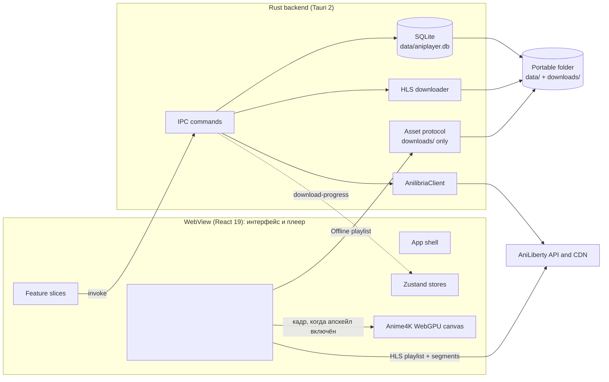

# Architecture overview

Date: 2026-11-04

Aniplayer is a Tauri 2 desktop app: a React WebView that is also the player, a Rust backend for catalog access, local storage, downloads and the verdict on what may be played, and a portable folder that carries the executable and the user's data. This document maps the current code; when it and the code disagree, the code wins and this document is a defect. See [GLOSSARY.md](../GLOSSARY.md) for the domain vocabulary and [docs/adr/](adr/) for the decisions behind the shape.

## System shape



Two facts that shape the rest of this document:

- Catalog calls go through the Rust client first and fall back to direct HTTP.
- **The WebView is the only playback backend** ([ADR 0014](adr/0014-webview-is-the-only-playback-backend.md)). A `<video>` element fed by hls.js through Media Source Extensions plays both the online HLS stream and a downloaded Offline playlist; the Rust backend decodes no media, spawns nothing, and ships no media runtime. What stays in Rust is the decision about _which_ source may be loaded at all.

## Layers and ownership

### WebView UI

- Entry point: `index.html` → `src/main.tsx`.
- Application shell: `src/app/App.tsx` and `src/app/Header.tsx`. The shell only composes features: screen selection, store lifecycle effects, and shell chrome. Feature-specific markup lives inside the owning feature.
- Feature slices under `src/features/`: `catalog`, `release`, `continue-watching`, `player`, `downloads`, `bookmarks`, `settings`. Each slice owns the UI, hooks, and state it needs, and exposes a public surface through its `index.ts`; not every slice has all three.
- The player feature owns the renderer as well as the interface: `src/features/player/renderer/` holds the hls.js session (`playbackSession.ts`), the source adapter (`sourceUrl.ts`), the Anime4K WebGPU renderer (`anime4kRenderer.ts`, the only module that reaches the GPU), the enhancement verdict (`useEnhancement.ts`) and the two hooks that connect the store and the media element (`usePlaybackEvents`, `usePlaybackSurface`). Nothing outside the feature touches them.
- Shared layer: `src/shared/types` (API and domain types), `src/shared/ui` (Radix-based primitives), `src/shared/lib` (API base URLs, the Tauri-runtime check, release helpers).
- State is client-side and optimistic: `catalogStore` holds catalog screens, cached Releases, bookmarks, and history; `playerStore` holds playback state and Settings and drives the media element through the session; `downloadStore` holds downloads and subscribes to backend events.
- The UI also runs in a plain browser (`bun run dev` without Tauri) for catalog work. In that mode catalog calls fall back to direct `fetch`, bookmarks and settings fall back to browser storage, and downloads are unavailable.

Boundary rule, enforced by `tests/test_feature_boundaries.test.ts`:

- A feature may import its own internals, the shared layer, and other features only through `@/features/<name>` (the barrel).
- Importing another feature's internals (`@/features/<name>/ui/...`) is a test failure.
- Code outside `src/features` reaches features only through their barrels.

### IPC boundary

The WebView reaches Rust through `invoke` from `@tauri-apps/api/core`. Commands are grouped by domain in `src-tauri/src/commands/` and registered in one `generate_handler!` list in `src-tauri/src/lib.rs`. No player command is `async` any more: nothing waits on a session mutex, and a command that only inspects the filesystem runs on the thread it is handed.

| Command family  | Commands                                                                                       | Rust service                                 |
| --------------- | ---------------------------------------------------------------------------------------------- | -------------------------------------------- |
| `api_*`         | status, latest releases, schedule, genres, genre releases, release details, franchises, search | `AnilibriaClient` (`src-tauri/src/api`)      |
| `db_*`          | bookmarks, history, continue watching, settings, download metadata, downloaded-episode index   | `Database` (`src-tauri/src/db`)              |
| `downloader_*`  | HLS episode/release download, cancel, delete, open folder                                      | `HlsDownloader` (`src-tauri/src/downloader`) |
| `player_*`      | resolve_source                                                                                 | `playback::resolve_source`                   |
| `app_*`, `ping` | ping, fullscreen                                                                               | Tauri window                                 |

Backend events are one-way, Rust → WebView:

- `download-progress` — per-episode HLS progress: segment counts, bytes transferred, mean throughput, percentage, status and error. A COMPLETED line makes `downloadStore` reload the downloaded-episode index, and a CANCELLED one drops the task from the queue.

Playback state needs no event channel: it is read off the media element the page owns.

### Rust services

`startup::bootstrap` is the composition root. It resolves the application directory, opens the database, drops the Downloaded episodes an older build indexed from torrent payloads, creates the HLS downloader, and builds `AppState`; each fallible step fails with an actionable `StartupError` that is shown in a native dialog. Nothing half-started is left behind, and nothing is supervised after the start: there is no child process to keep glued to the main window.

`AppState` holds `Arc`s to the database, API client, HLS downloader, and the application directory.

| Module                    | Responsibility                                                                                                                                                             |
| ------------------------- | -------------------------------------------------------------------------------------------------------------------------------------------------------------------------- |
| `api/`                    | `reqwest` client for AniLiberty endpoints, response models, URL encoding.                                                                                                  |
| `commands/`               | Thin IPC adapters: validation, locking, delegation, event emission. No business logic beyond argument shaping.                                                             |
| `db/`                     | `Database` (one `Mutex<Connection>`), schema creation, repository methods, row models.                                                                                     |
| `downloader/hls.rs`       | Fetches m3u8 playlists, segments, init and key resources, writes files, tracks cancel flags, persists status and Skip timecodes, emits progress with bytes and throughput. |
| `playback.rs`             | The one gate on what may be played: `resolve_source` re-parses a stream URL or canonicalizes a downloaded file inside `downloads/`, and refuses everything else.           |
| `startup.rs` / `state.rs` | Bootstrap, path resolution, the legacy-download purge, fatal-error reporting, and the managed application state.                                                           |

## Data flows

### Catalog and library

1. `App` mounts and calls `catalogStore.loadInitialData()`: `api_get_latest_releases` and `db_get_all_history`, then bookmarks and genres.
2. Search, genre pagination, release details, and franchises call the matching `api_*` command. If the command fails, the store falls back to a direct `fetch` against the same AniLiberty base URL; in a plain browser the fallback is the only path.
3. Release details are cached in the store and in browser storage; a bookmark stores a JSON snapshot of the Release.
4. Bookmarks and watch progress are optimistic in the store and persisted through `db_save_bookmark` / `db_save_history`. Watch progress is saved at most every 4 seconds while playing and on pause/unmount; an Episode becomes completed at 90% of its duration.

### Playback session

1. `playerStore.openPlayer` receives a Release and an Episode. If the Episode has no HLS URLs, it loads full Release details through `api_get_release`.
2. `App` renders `LazyPlayerOverlay` inside `Suspense`. The overlay draws `PlayerVideoViewport`, which is the frame itself: a `<video>` element for the session to bind to.
3. `resolvePlayableUrl` asks `player_resolve_source` for the Episode's stored source and gets back the URL to load: a stream URL re-parsed by the Rust URL parser, or an asset-protocol URL whose percent-encoded segments spell out the file's folder. The folder has to stay addressable, because the Offline playlist names its segments bare filenames and hls.js resolves them against that directory. Outside Tauri — the browser catalog mode — the source is already a stream URL.
4. `playback.open(url, start, settings)` records the request, and the session dynamic-imports hls.js, attaches it to the element the view provided, and loads the playlist. The order does not matter: `open()` before `attach()` keeps the request pending, `attach()` before `open()` binds what is already playing. That is what lets React remount the overlay in development without taking the picture down ([#48](https://github.com/shidot3m/aniplayer/issues/48)).
5. Resume: the start position from Watch progress is applied when the element reports `loadedmetadata`, then playback begins. Controls call `setPaused`, `seek`, `setVolume`, `setSpeed` straight onto the element, and `timeupdate` / `ended` return through `usePlaybackEvents` into `playerStore.updateTime`, which drives auto-skip of opening/ending timecodes, autoplay of the next Episode, and persistence of watch progress.
6. The store owns that lifetime, not the view: `openPlayer` starts the session, `closePlayer` ends it, and a fault ends it through `reportFault` while the overlay stays mounted to show the reason. Unmount still saves watch progress.
7. A fatal hls.js media error gets one `recoverMediaError()` attempt; after that — and on any fatal network error — the overlay shows a Russian explanation and the session ends. There is no codec-capability probe and no remux layer: nothing asks the machine whether it can decode before trying ([ADR 0009](adr/0009-matroska-remux-and-codec-probe.md) stays superseded).
8. Quality is not an HLS level here: every AniLiberty tier is its own media playlist, so `setQuality` resolves that tier's URL and calls `switchUrl`, which reloads the source under the live element and carries the position and the paused state over. The session is never restarted ([#50](https://github.com/shidot3m/aniplayer/issues/50)).

### Offline playback

1. `DownloadsView` reads the downloaded-episode index through `db_get_all_downloaded_episodes`.
2. The stored `file_path` — an Offline playlist `index.m3u8`, or the single file a pre-playlist layout left behind — goes to `player_resolve_source` unchanged. It canonicalizes the path, refuses anything that is not a file inside the app's `downloads/` folder, and answers with the asset-protocol URL of that file. hls.js resolves segment, `#EXT-X-MAP` init and `#EXT-X-KEY` URIs against the same folder, so a downloaded Episode plays with the network off.
3. Seeking, Quality, Skip timecodes and Watch progress are the same calls as online playback.

### Anime4K

The enhancement is a WebGPU renderer drawn over the media element ([ADR 0015](adr/0015-anime4k-as-a-webgpu-renderer.md)); the mpv GLSL chain left the tree with the subprocess backend.

1. Settings holds the two Preferences — `anime4k_enabled` and `anime4k_preset` — through `db_save_setting`, and the player menu holds the switch. Both apply to a live Episode: the choice is read by the surface, not by the session.
2. `useEnhancement` is the one verdict shared by the menu, the Settings tab, the badge in the top bar and the playback surface: whether the frame is filtered, and what stops it from being. Without `navigator.gpu` the control is disabled with the reason shown in its place and the element stays untouched; a preference saved on another machine cannot make the UI promise a filtered frame.
3. When the verdict is "on", `PlayerVideoViewport` mounts `Anime4kCanvas` over the element and puts the element at `opacity-0` — still decoding, still driving the audio clock — and the canvas dynamic-imports `renderer/anime4kRenderer`, so the shader tables are fetched only for a user who switched the enhancement on.
4. The renderer asks for an adapter, copies each frame the element presents (`requestVideoFrameCallback`, with `seeked` forcing a redraw) into an input texture, runs the preset's pipeline from `anime4k-webgpu`, and blits the pipeline's output to the canvas. If the adapter or the canvas context is refused, the renderer reports the reason into `enhancementFault`, the verdict goes to "not active", the canvas unmounts and the element is visible again: never a black plate over a live picture. The control stays usable — switching off and on drops the recorded reason and asks the GPU again, because a refused adapter once is not a missing feature.
5. Six presets, one per pipeline the package exports (Mode A, A+A, B, B+B, C, C+A). A stored name that is not one of them resolves to the default, so no Setting can address a filter that does not exist.
6. Switching the enhancement off or changing the preset stops the renderer and rebuilds it on the same canvas; the session, the position and the audio are never interrupted.

### HLS download

1. A release or episode action sends one `DownloadEpisodeItem` per episode to `downloader_start_episode` or `downloader_start_release`.
2. The command spawns a Tokio task; `HlsDownloader::download_episode` records a DOWNLOADING row with the Skip timecodes, then fetches the playlist.
3. `prepare_local_playlist` resolves the segment URIs against the playlist URL and rewrites the URI lines to `segment-NNNNN.ts`, preserving `#EXTINF` and the other tags and closing the playlist with `#EXT-X-ENDLIST`. `#EXT-X-MAP` init segments and `#EXT-X-KEY` keys are downloaded beside the playlist and rewritten to local names, because the player replays the folder from disk; only master (`#EXT-X-STREAM-INF`) and byte-range (`#EXT-X-BYTERANGE`) playlists are rejected.
4. Segments are written to `downloads/<release_id>/<ordinal>/`, then the playlist is written as `index.m3u8`. The row is updated to COMPLETED with the size of segments plus playlist. Failures remove the folder and become FAILED; cancellation deletes the folder and the row. A whole-release action is one queue that walks its Episodes serially and checks its own cancel flag between them, so `downloader_cancel_all` stops the queue and not only the Episode running at that moment, while cancelling a single Episode leaves the rest queued. Starting the same Release again supersedes the older queue rather than racing it. `test_download_queue` holds that contract.
5. Progress is emitted as `download-progress` per segment — bytes written so far, mean throughput, percentage from the segment count — and consumed by `downloadStore` and the floating widget; completion triggers a reload of the downloaded-episode index. This is the only way an Episode reaches the device ([ADR 0013](adr/0013-hls-only-delivery-drops-bittorrent.md)).

### Settings

`playerStore.initSettings` reads persisted Settings through `db_get_setting`. Volume, preferred Quality, Anime4K preset, Anime4K enabled, and hotkeys are written through `db_save_setting`. Auto-skip and autoplay toggles currently live only in the session state.

## Runtime asset layout

Portable bundle (the only distributed artifact):

```text
Aniplayer/
├─ aniplayer.exe
├─ data/
│  └─ aniplayer.db
└─ downloads/
   ├─ <release_id>/
   │  └─ <ordinal>/
   │     ├─ index.m3u8                    # local HLS playlist
   │     ├─ segment-NNNNN.ts              # HLS segments
   │     ├─ init-NNNNN.mp4                # #EXT-X-MAP init segments
   │     └─ key-NNNNN.key                 # #EXT-X-KEY keys
   └─ torrents/                           # what an older build left; nothing here is listed or played
```

All paths are relative to the executable's directory (`startup::app_dir`). The archive carries no
media runtime and no shader directory: hls.js is frontend code inside the bundle, WebView2 is
the decoder, and the Anime4K WGSL tables are frontend code too — a chunk of the bundle that the
guard test keeps off the startup path. `scripts/package_portable.py` stages the folder, and the release workflow fails a zip
that still contains `mpv/` or `shaders/`.

## Persistence

`data/aniplayer.db` is the local-first store (see [ADR 0004](adr/0004-sqlite-local-first-store.md)):

- `bookmarks` — Release id, category, JSON snapshot, timestamps.
- `history` — (Release, Episode) playback position, duration, completion flag, timestamp.
- `downloaded_episodes` — file path, size, Quality, Skip timecodes, Download status.
- `app_settings` — string key/value pairs.

There is no migration framework: the initializer creates missing tables only. Changing an existing table requires an explicit migration and a test.

One data cleanup runs outside the schema, in `startup::purge_legacy_torrent_downloads`: the Downloaded episodes an older build indexed from torrent payloads carry the `torrent-` id prefix, and they leave `downloaded_episodes` on every launch. It is one `DELETE` over a table the size of the user's library, so it needs no version marker, and it never touches a file — the media an old build downloaded stays on disk and simply stops being listed.

## Security boundaries

- The production CSP is restrictive and is contract-tested, together with the development policy and the window configuration, in `src-tauri/tests/test_security_config.rs`. The WebView now hosts the media stack, so the policy names exactly what it needs and nothing more: `media-src blob:` (the MediaSource object URL), `worker-src 'self' blob:` (the transmuxer worker hls.js builds from a blob), and a `connect-src` carrying the IPC origins, the asset-protocol origins, and `https:` for the CDN. The development CSP relaxes only the Vite dev server (`script-src` inline, local HMR socket).
- The asset protocol is enabled, and `run_with_state` grants its scope at startup to `app_dir/downloads` recursively — the same root `resolve_source` canonicalizes against, so the two gates agree and no path is spelled twice. The configuration declares no scope pattern: `tauri.conf.json` has no variable for the executable's own folder, and a pattern the runtime cannot resolve is dropped silently, which would leave the page with 403 for every downloaded file.
- `player_resolve_source` validates its source in Rust and answers with a URL: `http(s)` is re-parsed and re-serialized, a local path must canonicalize inside the app's `downloads/` folder and be a file. The frontend never names a path it is not allowed to read, and nothing from the page is interpolated into an argument.
- The capability file grants `core:default` and `core:window:default` and nothing else: the page opens no URL and no path in the operating system. Revealing a downloads folder is a Rust-side call (`downloader_open_folder`), so it needs no webview permission. The guard test fails if an `opener:` or `shell:` permission, or a `magnet` scope, reappears.
- The app binds no listening socket and joins no peer network. Outbound HTTP to the AniLiberty API and CDN is the whole surface ([ADR 0013](adr/0013-hls-only-delivery-drops-bittorrent.md)).

## Current state and tracked gaps

- **Quality switching reloads the tier's playlist.** `setQuality` keeps the session, the position and the paused state, but the switch is not gapless: the new source is fetched and transmuxed from the seek point.
- **The retry policy is still hls.js's default.** AniLiberty redirects every segment to a rotating CDN host — the behaviour that wedged the mpv player in [#45](https://github.com/shidot3m/aniplayer/issues/45) — and the webview stack needs its own bounded answer. That is [#62](https://github.com/shidot3m/aniplayer/issues/62), which sets segment and manifest retry counts, backoff and fatal-error handling deliberately instead of inheriting the library's.
- **No subtitle track is exposed.** mpv selected embedded tracks with `--slang=en,ru`; the media element shows none, and the measured catalog carries no text tracks today. Tracked as [#64](https://github.com/shidot3m/aniplayer/issues/64).

## Verification gates

- Frontend: `bun run typecheck`, `bun run lint` (Biome), `bun run test` (Vitest), `bunx aislop ci`, `bun run build`.
- JS toolchain: Bun only ([ADR 0011](adr/0011-bun-as-the-js-toolchain.md)) — a CI guard step fails when an npm/npx reference appears in `.github/workflows/` or `scripts/`.
- Rust: `cargo fmt --check`, `cargo clippy --all-targets --locked -- -D warnings`, `cargo audit`, and the hermetic test suites listed in `.github/workflows/ci.yml` — including `test_playback_source`, which holds the source verdict (a URL re-parsed, a path confined to the downloads folder, every other scheme refused), `test_download_queue`, which holds the cancel-one-versus-cancel-all contract of the release queue, and `test_startup`, which also proves the legacy purge drops torrent rows idempotently and leaves HLS rows and disk files alone.
- Frontend playback: the player feature is rendered through React Testing Library with hls.js stubbed as a module boundary (`tests/setup.ts`), covering online, offline, Quality, resume and both error paths, and `tests/test_bundle_split.test.ts` keeps the loader out of the entry chunk.
- Frontend enhancement: the WebGPU renderer is the other stubbed boundary (`tests/helpers/enhancementStubs.ts`), so `tests/test_anime4k_enhancement.test.tsx` covers switching on and off over a live Episode, a preset change that rebuilds the renderer, the disabled control without `navigator.gpu`, and the fallback when the renderer itself refuses — with no assertion about shader internals. `tests/test_anime4k_presets.test.ts` checks the preset list against the pipelines the package really exports, and the bundle guard holds the renderer chunk in its own tier and out of the eager graph.
- Packaging: `scripts/package_portable.py` stages only the executable and an empty `data/`, and the release workflow asserts the archive carries neither `mpv/` nor `shaders/`.
- Feature boundaries, bundle budgets, CSP parity, the playback-source confinement, the asset-protocol scope, the single-window stack and the closed capability surface are enforced by tests, not by convention alone.
