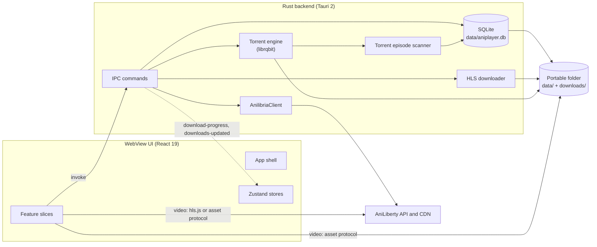

# Architecture overview

Date: 2026-11-02

Aniplayer is a Tauri 2 desktop app: a React WebView for the interface and playback, a Rust backend for catalog access, local storage, and downloads, and a portable folder that carries every runtime asset. This document maps the current code; when it and the code disagree, the code wins and this document is a defect. See [GLOSSARY.md](../GLOSSARY.md) for the domain vocabulary and [docs/adr/](adr/) for the decisions behind the shape.

## System shape



Two facts that shape the rest of this document:

- Catalog calls go through the Rust client first and fall back to direct HTTP; online playback always travels directly from the WebView to the AniLiberty CDN. Local files travel through Tauri's asset protocol.
- Playback happens entirely in the WebView: a `<video>` element driven by hls.js for online HLS, the same element fed by the asset protocol for downloads, and Anime4K enhancement on a WebGPU canvas. The Rust backend never decodes video.

## Layers and ownership

### WebView UI

- Entry point: `index.html` → `src/main.tsx`.
- Application shell: `src/app/App.tsx` and `src/app/Header.tsx`. The shell only composes features: screen selection, store lifecycle effects, and shell chrome. Feature-specific markup lives inside the owning feature.
- Feature slices under `src/features/`: `catalog`, `release`, `continue-watching`, `player`, `downloads`, `bookmarks`, `settings`. Each slice owns the UI, hooks, and state it needs, and exposes a public surface through its `index.ts`; not every slice has all three.
- Shared layer: `src/shared/types` (API and domain types), `src/shared/ui` (Radix-based primitives), `src/shared/lib` (API base URLs and release helpers).
- State is client-side and optimistic: `catalogStore` holds catalog screens, cached Releases, bookmarks, and history; `playerStore` holds playback state and Settings; `downloadStore` holds downloads and subscribes to backend events.
- The UI also runs in a plain browser (`npm run dev` without Tauri) for catalog work. In that mode catalog calls fall back to direct `fetch`, bookmarks and settings fall back to browser storage, and downloads are unavailable.

Boundary rule, enforced by `tests/test_feature_boundaries.test.ts`:

- A feature may import its own internals, the shared layer, and other features only through `@/features/<name>` (the barrel).
- Importing another feature's internals (`@/features/<name>/ui/...`) is a test failure.
- Code outside `src/features` reaches features only through their barrels.

### IPC boundary

The WebView reaches Rust through `invoke` from `@tauri-apps/api/core`. Commands are grouped by domain in `src-tauri/src/commands/` and registered in one `generate_handler!` list in `src-tauri/src/lib.rs`.

| Command family  | Commands                                                                                                                        | Rust service                                          |
| --------------- | ------------------------------------------------------------------------------------------------------------------------------- | ----------------------------------------------------- |
| `api_*`         | status, latest releases, schedule, genres, genre releases, release details, torrents, franchises, search                        | `AnilibriaClient` (`src-tauri/src/api`)               |
| `db_*`          | bookmarks, history, continue watching, settings, download metadata, downloaded-episode index                                    | `Database` (`src-tauri/src/db`)                       |
| `downloader_*`  | HLS episode/release download, cancel, delete, open folder, torrent file download, magnet opening, embedded torrent start/cancel | `HlsDownloader`, `TorrentDownloader`, `TorrentEngine` |
| `app_*`, `ping` | ping, fullscreen                                                                                                                | Tauri window                                          |

Backend events are one-way, Rust → WebView:

- `download-progress` — per-episode HLS progress and per-torrent progress; `downloadStore` normalizes both shapes.
- `downloads-updated` — emitted after torrent scanning; the store reloads the downloaded-episode index.

### Rust services

`startup::bootstrap` is the composition root. It resolves the application directory, opens the database, creates the HLS downloader and the torrent engine, and builds `AppState`; each fallible step fails with an actionable `StartupError` that is shown in a native dialog. Nothing half-started is left behind.

`AppState` holds `Arc`s to the database, API client, HLS downloader, torrent file downloader, torrent engine, and the application directory.

| Module                         | Responsibility                                                                                                              |
| ------------------------------ | --------------------------------------------------------------------------------------------------------------------------- |
| `api/`                         | `reqwest` client for AniLiberty endpoints, response models, URL encoding.                                                   |
| `commands/`                    | Thin IPC adapters: validation, locking, delegation, event emission. No business logic beyond argument shaping.              |
| `db/`                          | `Database` (one `Mutex<Connection>`), schema creation, repository methods, row models.                                      |
| `downloader/hls.rs`            | Fetches m3u8 playlists and segments, writes files, tracks cancel flags, persists status and Skip timecodes, emits progress. |
| `downloader/torrent.rs`        | Torrent-file download from the API, magnet and path validation, opening through the OS handler.                             |
| `downloader/torrent_engine.rs` | Long-lived `librqbit` session, torrent tracking tasks, progress sampling, completion hook.                                  |
| `downloader/scanner.rs`        | Extracts Ordinals from video filenames and indexes completed torrent files into `downloaded_episodes`.                      |
| `startup.rs` / `state.rs`      | Bootstrap, path resolution, fatal-error reporting, and the managed application state.                                       |

## Data flows

### Catalog and library

1. `App` mounts and calls `catalogStore.loadInitialData()`: `api_get_latest_releases` and `db_get_all_history`, then bookmarks and genres.
2. Search, genre pagination, release details, torrents, and franchises call the matching `api_*` command. If the command fails, the store falls back to a direct `fetch` against the same AniLiberty base URL; in a plain browser the fallback is the only path.
3. Release details are cached in the store and in browser storage; a bookmark stores a JSON snapshot of the Release.
4. Bookmarks and watch progress are optimistic in the store and persisted through `db_save_bookmark` / `db_save_history`. Watch progress is saved at most every 4 seconds while playing and on pause/unmount; an Episode becomes completed at 90% of its duration.

### Online playback (current Player overlay)

1. `playerStore.openPlayer` receives a Release and an Episode. If the Episode has no HLS URLs, it loads full Release details through `api_get_release`.
2. `App` renders `LazyPlayerOverlay` inside `Suspense`; this is the only entry that pulls in hls.js and Anime4K WebGPU.
3. `usePlayerControllers` selects the HLS URL for the active Quality and `useHlsVideo` attaches it to a `<video>` element through hls.js. A local asset URL skips hls.js and is loaded directly.
4. Time updates drive auto-skip of opening/ending timecodes, autoplay of the next Episode, and persistence of watch progress.
5. When Anime4K is enabled, `Anime4kCanvas` dynamic-imports `anime4kRenderer` and renders the enhanced frame on a canvas over the `<video>` element. The renderer is the only code that imports `anime4k-webgpu`.

### Offline playback

1. `DownloadsView` reads the downloaded-episode index through `db_get_all_downloaded_episodes`.
2. It converts the stored path with `offlineStreamUrl`, which wraps Tauri's `convertFileSrc` and returns an asset-protocol URL.
3. `useHlsVideo` detects the asset URL, skips hls.js, and assigns it directly to `<video>`; the file is served by the asset protocol within the configured scope.

### HLS download

1. A release or episode action sends one `DownloadEpisodeItem` per episode to `downloader_start_episode` or `downloader_start_release`.
2. The command spawns a Tokio task; `HlsDownloader::download_episode` records a DOWNLOADING row with the Skip timecodes, then fetches the playlist and segments.
3. Segments are written to `downloads/<release_id>/<ordinal>.mp4`, and the row is updated to COMPLETED with size and quality. Failures become FAILED; cancellation deletes the file and the row.
4. Progress is emitted as `download-progress` and consumed by `downloadStore`; completion triggers a reload of the downloaded-episode index.

### Torrent download

1. `downloadStore.startTorrentDownload` calls `downloader_start_torrent` with a magnet or URL.
2. `TorrentEngine` adds the torrent to the shared `librqbit` session with an output folder of `downloads/torrents/<release_id>/`.
3. A tracking task samples statistics every 500 ms and emits `download-progress`.
4. On completion the scanner walks the folder, extracts Ordinals, and upserts `downloaded_episodes` rows. `downloads-updated` then makes the UI reload the index, and the episodes become playable offline.

### Settings

`playerStore.initSettings` reads persisted Settings through `db_get_setting`. Volume, preferred Quality, Anime4K preset, Anime4K enabled, and hotkeys are written through `db_save_setting`. Auto-skip and autoplay toggles currently live only in the session state.

## Runtime asset layout

Portable bundle (the only distributed artifact):

```text
Aniplayer/
├─ aniplayer.exe
├─ data/
│  └─ aniplayer.db
└─ downloads/
   ├─ <release_id>/<ordinal>.mp4          # HLS downloads
   └─ torrents/
      ├─ *.torrent                        # downloaded torrent files
      └─ <release_id>/                    # torrent payload
```

All paths are relative to the executable's directory (`startup::app_dir`).

## Persistence

`data/aniplayer.db` is the local-first store (see [ADR 0004](adr/0004-sqlite-local-first-store.md)):

- `bookmarks` — Release id, category, JSON snapshot, timestamps.
- `history` — (Release, Episode) playback position, duration, completion flag, timestamp.
- `downloaded_episodes` — file path, size, Quality, Skip timecodes, Download status.
- `app_settings` — string key/value pairs.

There is no migration framework: the initializer creates missing tables only. Changing an existing table requires an explicit migration and a test.

## Security boundaries

- The production CSP is restrictive and is contract-tested in `src-tauri/tests/test_security_config.rs`. The development CSP relaxes only the Vite dev server (`script-src` inline, local HMR socket).
- The asset protocol is enabled and scoped to `$RESOURCE/downloads/**`; downloaded files never reach the WebView by other means.
- The opener capability allows only `magnet:` URLs. The old shell plugin is gone.
- Magnet links are validated before reaching the torrent engine, and `.torrent` paths must canonicalize inside the torrents folder.

## Current state and tracked gaps

- **HLS files are concatenated MPEG-TS bytes with an `.mp4` extension.** The downloader does not remux; playback of these files in WebView2 is tracked in [#35](https://github.com/shidot3m/aniplayer/issues/35).
- **Torrent playback requires a complete download.** There is no piece-level streaming path; the scanner runs only after `librqbit` reports completion.
- **The `librqbit-utp` patch is temporary.** It exists for RUSTSEC-2026-0293 and is tracked in [#37](https://github.com/shidot3m/aniplayer/issues/37).

## Verification gates

- Frontend: `npm run typecheck`, `npm run lint` (Biome), `npm run test` (Vitest), `npx aislop ci`, `npm run build`.
- Rust: `cargo fmt --check`, `cargo clippy --all-targets --locked -- -D warnings`, `cargo audit`, and the hermetic test suites listed in `.github/workflows/ci.yml`.
- Feature boundaries, bundle budgets, CSP parity, and the asset-protocol scope are enforced by tests, not by convention alone.
