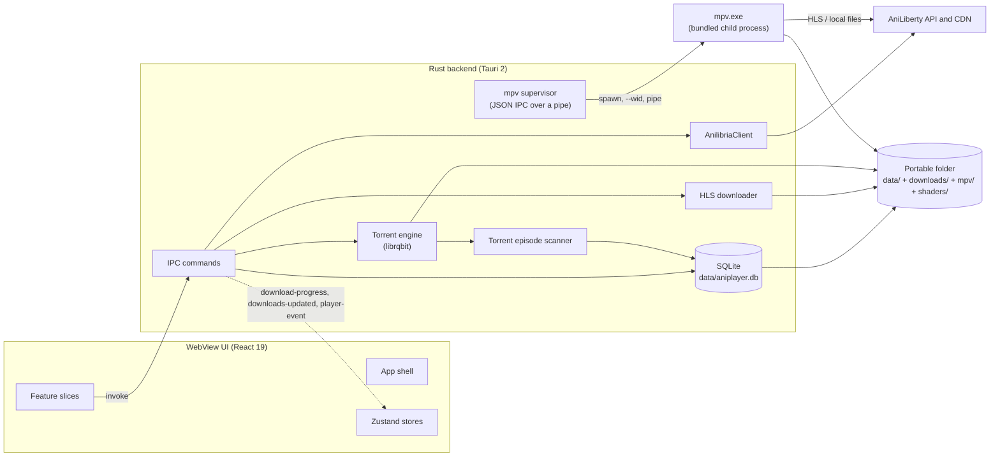

# Architecture overview

Date: 2026-11-02

Aniplayer is a Tauri 2 desktop app: a React WebView for the interface, a Rust backend for catalog access, local storage, downloads, and the mpv player it supervises, and a portable folder that carries every runtime asset. This document maps the current code; when it and the code disagree, the code wins and this document is a defect. See [GLOSSARY.md](../GLOSSARY.md) for the domain vocabulary and [docs/adr/](adr/) for the decisions behind the shape.

## System shape



Two facts that shape the rest of this document:

- Catalog calls go through the Rust client first and fall back to direct HTTP. Video bytes never travel through the WebView: mpv fetches HLS from the CDN or reads downloaded files itself.
- **mpv is the only playback backend** ([ADR 0010](adr/0010-mpv-subprocess-as-the-only-playback-backend.md)). The `<video>` element is not a player; the WebView draws only the control overlay. The Rust backend never decodes or rewrites media — the bundled `mpv/mpv.exe` child process does, and the app talks to it over JSON IPC on a named pipe.

## Layers and ownership

### WebView UI

- Entry point: `index.html` → `src/main.tsx`.
- Application shell: `src/app/App.tsx` and `src/app/Header.tsx`. The shell only composes features: screen selection, store lifecycle effects, and shell chrome. Feature-specific markup lives inside the owning feature.
- Feature slices under `src/features/`: `catalog`, `release`, `continue-watching`, `player`, `downloads`, `bookmarks`, `settings`. Each slice owns the UI, hooks, and state it needs, and exposes a public surface through its `index.ts`; not every slice has all three.
- Shared layer: `src/shared/types` (API and domain types), `src/shared/ui` (Radix-based primitives), `src/shared/lib` (API base URLs and release helpers).
- State is client-side and optimistic: `catalogStore` holds catalog screens, cached Releases, bookmarks, and history; `playerStore` holds playback state and Settings and drives mpv through the `player_*` commands; `downloadStore` holds downloads and subscribes to backend events.
- The UI also runs in a plain browser (`npm run dev` without Tauri) for catalog work. In that mode catalog calls fall back to direct `fetch`, bookmarks and settings fall back to browser storage, and downloads are unavailable.

Boundary rule, enforced by `tests/test_feature_boundaries.test.ts`:

- A feature may import its own internals, the shared layer, and other features only through `@/features/<name>` (the barrel).
- Importing another feature's internals (`@/features/<name>/ui/...`) is a test failure.
- Code outside `src/features` reaches features only through their barrels.

### IPC boundary

The WebView reaches Rust through `invoke` from `@tauri-apps/api/core`. Commands are grouped by domain in `src-tauri/src/commands/` and registered in one `generate_handler!` list in `src-tauri/src/lib.rs`.

| Command family  | Commands                                                                                                                        | Rust service                                          |
| --------------- | ------------------------------------------------------------------------------------------------------------------------------- | ----------------------------------------------------- |
| `api_*`         | status, latest releases, schedule, genres, genre releases, release details, torrents, franchises, search                        | `AnilibriaClient` (`src-tauri/src/api`)               |
| `db_*`          | bookmarks, history, continue watching, settings, download metadata, downloaded-episode index                                    | `Database` (`src-tauri/src/db`)                       |
| `downloader_*`  | HLS episode/release download, cancel, delete, open folder, torrent file download, magnet opening, embedded torrent start/cancel | `HlsDownloader`, `TorrentDownloader`, `TorrentEngine` |
| `player_*`      | open, close, set_pause, seek, set_volume, set_speed, set_anime4k                                                                | `MpvSupervisor` (`src-tauri/src/player`)              |
| `app_*`, `ping` | ping, fullscreen                                                                                                                | Tauri window                                          |

Backend events are one-way, Rust → WebView:

- `download-progress` — per-episode HLS progress and per-torrent progress; `downloadStore` normalizes both shapes.
- `downloads-updated` — emitted after torrent scanning; the store reloads the downloaded-episode index.
- `player-event` — mpv playback updates translated from JSON IPC: `time` (position + duration), `ended`, `fault`, `hardwareDecoder`; `useNativePlayer` feeds them into `playerStore`.

### Rust services

`startup::bootstrap` is the composition root. It resolves the application directory, opens the database, creates the HLS downloader and the torrent engine, and builds `AppState`; each fallible step fails with an actionable `StartupError` that is shown in a native dialog. Nothing half-started is left behind.

`AppState` holds `Arc`s to the database, API client, HLS downloader, torrent file downloader, torrent engine, the mpv supervisor, and the application directory. The builder registers a window-event hook that keeps the video window glued to the main window and stops mpv when the main window closes.

| Module                         | Responsibility                                                                                                                                                                                                                                                                                                                                                                 |
| ------------------------------ | ------------------------------------------------------------------------------------------------------------------------------------------------------------------------------------------------------------------------------------------------------------------------------------------------------------------------------------------------------------------------------ |
| `api/`                         | `reqwest` client for AniLiberty endpoints, response models, URL encoding.                                                                                                                                                                                                                                                                                                      |
| `commands/`                    | Thin IPC adapters: validation, locking, delegation, event emission. No business logic beyond argument shaping.                                                                                                                                                                                                                                                                 |
| `db/`                          | `Database` (one `Mutex<Connection>`), schema creation, repository methods, row models.                                                                                                                                                                                                                                                                                         |
| `downloader/hls.rs`            | Fetches m3u8 playlists, segments, init and key resources, writes files, tracks cancel flags, persists status and Skip timecodes, emits progress.                                                                                                                                                                                                                               |
| `downloader/torrent.rs`        | Torrent-file download from the API, magnet and path validation, opening through the OS handler.                                                                                                                                                                                                                                                                                |
| `downloader/torrent_engine.rs` | Long-lived `librqbit` session, torrent tracking tasks, progress sampling, completion hook.                                                                                                                                                                                                                                                                                     |
| `downloader/scanner.rs`        | Extracts Ordinals and indexes every video file mpv can be pointed at; no codec or container gate.                                                                                                                                                                                                                                                                              |
| `player/`                      | The mpv lifecycle: `supervisor.rs` spawns and owns the child, attaches it to the `native-player` window, and validates sources; `ipc.rs` carries commands to the pipe on a writer thread, judges whether mpv is still answering them, and watches for the wedge; `events.rs` turns mpv property events into `player-event`s; `shaders.rs` maps Anime4K presets to GLSL chains. |
| `startup.rs` / `state.rs`      | Bootstrap, path resolution, fatal-error reporting, and the managed application state.                                                                                                                                                                                                                                                                                          |

## Data flows

### Catalog and library

1. `App` mounts and calls `catalogStore.loadInitialData()`: `api_get_latest_releases` and `db_get_all_history`, then bookmarks and genres.
2. Search, genre pagination, release details, torrents, and franchises call the matching `api_*` command. If the command fails, the store falls back to a direct `fetch` against the same AniLiberty base URL; in a plain browser the fallback is the only path.
3. Release details are cached in the store and in browser storage; a bookmark stores a JSON snapshot of the Release.
4. Bookmarks and watch progress are optimistic in the store and persisted through `db_save_bookmark` / `db_save_history`. Watch progress is saved at most every 4 seconds while playing and on pause/unmount; an Episode becomes completed at 90% of its duration.

### Online playback (current Player overlay)

1. `playerStore.openPlayer` receives a Release and an Episode. If the Episode has no HLS URLs, it loads full Release details through `api_get_release`.
2. `App` renders `LazyPlayerOverlay` inside `Suspense`; the overlay owns no video element.
3. `playerStore` invokes `player_open` with the selected Quality's HLS URL plus the start position, volume, speed and Anime4K choice. `MpvSupervisor` creates (or reuses) the `native-player` window, spawns the bundled mpv with `--wid` attached to it, connects the JSON IPC pipe, and sends `loadfile`.
4. `useNativePlayer` subscribes to `player-event`; each `time` event drives `playerStore.updateTime`, which in turn drives auto-skip of opening/ending timecodes, autoplay of the next Episode, and persistence of watch progress. Controls invoke `player_set_pause`, `player_seek`, `player_set_volume`, `player_set_speed`; a `fault` closes the player and shows the reason. Every `player_*` command is dispatched off the main thread, because it waits on the session mutex that `player_open` holds while it asks the main thread to move and show the video window, and it only reaches the command queue — the pipe itself belongs to the writer thread.
5. Subtitles are mpv's too: `--slang=en,ru` picks the preferred embedded track; the app exposes no track menu of its own.
6. Anime4K is mpv's GLSL chain: `player_set_anime4k` sends `change-list glsl-shaders` with the preset's `;`-separated shader paths from `shaders/anime4k/`.

### Offline playback

1. `DownloadsView` reads the downloaded-episode index through `db_get_all_downloaded_episodes`.
2. The stored `file_path` — an Offline playlist `index.m3u8` or a downloaded media file — goes to `player_open` unchanged. `validated_source` canonicalizes it and refuses anything outside the app's `downloads/` folder; mpv then demuxes the local playlist, resolving segment, `#EXT-X-MAP` init and `#EXT-X-KEY` URIs against the folder on disk.
3. Seeking, Quality, Skip timecodes and Watch progress are the same IPC calls as online playback; container and codec no longer matter to the app.

### Native playback session

1. One mpv child serves the whole player. `player_open` on an existing session sends a new `loadfile` (quality switches and episode switches reuse the process); the pipe, the writer thread, the reader thread, the watchdog and the window stay.
2. Commands reach mpv through a queue that one writer thread drains, so no `player_*` call ever waits on the pipe: a write mpv never reads — the wedge in [#43](https://github.com/shidot3m/aniplayer/issues/43) — parks that thread alone. Every command carries a `request_id`, the reader thread marks the moment any line comes back, and a command left unanswered while the pipe has been silent for the stall deadline is reported as a `fault`, after which the watchdog kills mpv (which releases the parked write) and stops.
3. The reader thread translates mpv JSON lines into `player-event`s. If mpv dies or the pipe breaks, it emits `fault` and the frontend closes the player — the app itself never goes down with the child.
4. `MpvSession::drop` kills mpv, waits for it, and closes the video window; the main window loses its always-on-top flag. Closing the main window triggers the same stop through the window-event hook. That hook never waits on the session mutex (`player_open` holds it across window calls only the event loop services): it stops mpv through a child handle parked beside the mutex and reclaims the session with `try_lock`, handing the wait to a worker when a startup is in flight ([#44](https://github.com/shidot3m/aniplayer/issues/44)).
5. Every command argument is built as a structured JSON value or an argv entry; no path is interpolated into a shell string, and the pipe name is per-process and per-session.

### HLS download

1. A release or episode action sends one `DownloadEpisodeItem` per episode to `downloader_start_episode` or `downloader_start_release`.
2. The command spawns a Tokio task; `HlsDownloader::download_episode` records a DOWNLOADING row with the Skip timecodes, then fetches the playlist.
3. `prepare_local_playlist` resolves the segment URIs against the playlist URL and rewrites the URI lines to `segment-NNNNN.ts`, preserving `#EXTINF` and the other tags and closing the playlist with `#EXT-X-ENDLIST`. `#EXT-X-MAP` init segments and `#EXT-X-KEY` keys are downloaded beside the playlist and rewritten to local names, because mpv replays the folder from disk; only master (`#EXT-X-STREAM-INF`) and byte-range (`#EXT-X-BYTERANGE`) playlists are rejected.
4. Segments are written to `downloads/<release_id>/<ordinal>/`, then the playlist is written as `index.m3u8`. The row is updated to COMPLETED with the size of segments plus playlist. Failures remove the folder and become FAILED; cancellation deletes the folder and the row.
5. Progress is emitted as `download-progress` and consumed by `downloadStore`; completion triggers a reload of the downloaded-episode index.

### Torrent download

1. `downloadStore.startTorrentDownload` calls `downloader_start_torrent` with a magnet or URL.
2. `TorrentEngine` adds the torrent to the shared `librqbit` session with an output folder of `downloads/torrents/<release_id>/`.
3. A tracking task samples statistics every 500 ms and emits `download-progress`.
4. On completion the scanner walks the folder, extracts Ordinals, and indexes every video file as a `downloaded_episodes` row — mpv plays any container ffmpeg reads, so there is nothing to classify. `downloads-updated` then makes the UI reload the index, and the episodes become playable offline.

### Settings

`playerStore.initSettings` reads persisted Settings through `db_get_setting`. Volume, preferred Quality, Anime4K preset, Anime4K enabled, and hotkeys are written through `db_save_setting`. Auto-skip and autoplay toggles currently live only in the session state.

## Runtime asset layout

Portable bundle (the only distributed artifact):

```text
Aniplayer/
├─ aniplayer.exe
├─ mpv/
│  ├─ mpv.exe                             # pinned playback runtime
│  └─ *.dll                               # its FFmpeg/render libraries
├─ shaders/
│  └─ anime4k/*.glsl                      # Anime4K shader chain
├─ data/
│  └─ aniplayer.db
└─ downloads/
   ├─ <release_id>/
   │  └─ <ordinal>/
   │     ├─ index.m3u8                    # local HLS playlist
   │     ├─ segment-NNNNN.ts              # HLS segments
   │     ├─ init-NNNNN.mp4                # #EXT-X-MAP init segments
   │     └─ key-NNNNN.key                 # #EXT-X-KEY keys
   └─ torrents/
      ├─ *.torrent                        # downloaded torrent files
      └─ <release_id>/                    # torrent payload
```

All paths are relative to the executable's directory (`startup::app_dir`). `mpv/` and `shaders/` are staged by `scripts/get_mpv.py` and `scripts/package_portable.py`; the release workflow verifies the mpv archive's SHA-256 pin and the archive check asserts both directories are present.

## Persistence

`data/aniplayer.db` is the local-first store (see [ADR 0004](adr/0004-sqlite-local-first-store.md)):

- `bookmarks` — Release id, category, JSON snapshot, timestamps.
- `history` — (Release, Episode) playback position, duration, completion flag, timestamp.
- `downloaded_episodes` — file path, size, Quality, Skip timecodes, Download status.
- `app_settings` — string key/value pairs.

There is no migration framework: the initializer creates missing tables only. Changing an existing table requires an explicit migration and a test.

## Security boundaries

- The production CSP is restrictive and is contract-tested in `src-tauri/tests/test_security_config.rs`. The development CSP relaxes only the Vite dev server (`script-src` inline, local HMR socket). `media-src` is `'none'` and the asset protocol is disabled: the WebView loads no media at all, so there is no media surface on the web side to guard.
- `player_open` validates its source in Rust: `http(s)` URLs are re-parsed and re-serialized, local paths must canonicalize inside the app's `downloads/` folder and be a file. The frontend never names a pipe, a window, or an executable path.
- The mpv child runs with `--no-config`, no input bindings, no script paths, and an argv built in code; the JSON IPC pipe is private to the process.
- The opener capability allows only `magnet:` URLs. The old shell plugin is gone.
- Magnet links are validated before reaching the torrent engine, and `.torrent` paths must canonicalize inside the torrents folder. The same canonicalize-and-confine check gates local playback sources.

## Current state and tracked gaps

- **Torrent playback requires a complete download.** There is no piece-level streaming path: the scanner runs only after `librqbit` reports completion.
- **Quality switching reloads through mpv.** `setQuality` sends a new `loadfile` at the current position; the switch is not gapless.
- **mpv's stall on a struggling HLS stream is not reproduced by a flag change.** Measured on the stream [#43](https://github.com/shidot3m/aniplayer/issues/43) was filed from (AniLiberty release 10172, HLS 720p, bundled mpv v0.41.0, the app's own arguments): every segment fails the demuxer's keepalive and is refetched on a fresh connection — 51 `keepalive request failed` and 51 `Cannot reuse HTTP connection` warnings in 120 s of uninterrupted playback. `--demuxer-lavf-o=http_persistent=0` silences both warnings but ends the stream after 33–43 s with `tls: Unable to read from socket`, so it was rejected; the spawn keeps mpv's defaults and the player is instead hardened against the wedge. The trigger of the rare stall itself remains unconfirmed.
- **The `librqbit-utp` patch is temporary.** It pins the head of upstream `main` for RUSTSEC-2026-0293; that rev also carries the Windows uTP dispatcher fix. Tracked in [#37](https://github.com/shidot3m/aniplayer/issues/37).

## Verification gates

- Frontend: `npm run typecheck`, `npm run lint` (Biome), `npm run test` (Vitest), `npx aislop ci`, `npm run build`.
- Rust: `cargo fmt --check`, `cargo clippy --all-targets --locked -- -D warnings`, `cargo audit`, and the hermetic test suites listed in `.github/workflows/ci.yml` — including `test_player`, which exercises the mpv event translation and the Anime4K preset chains, and `test_player_ipc`, which exercises the command queue, the stall judgement and the watchdog.
- Packaging: the release workflow pins the mpv build by SHA-256 in `scripts/get_mpv.py`, and the archive check asserts `mpv/mpv.exe` and the Anime4K shaders are inside `Aniplayer-portable.zip`.
- Feature boundaries, bundle budgets, CSP parity, and the playback-source confinement are enforced by tests, not by convention alone.
