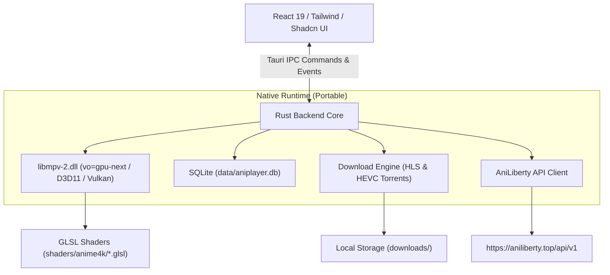

# Спецификация дизайна: Настольный аниме-плеер Aniplayer

**Дата составления:** 2026-09-14  
**Статус:** Утверждено (Approved Design Spec)  
**Платформа:** Windows 10/11 (Portable x64)  
**Стек:** Tauri v2, Rust 1.80+, React 19, TypeScript, Tailwind CSS, Shadcn UI, libmpv-2 (gpu-next), SQLite

---

## 1. Обзор проекта и ключевые цели

**Aniplayer** — высокопроизводительный портативный (portable) десктопный плеер для просмотра аниме с поддержкой аппаратного масштабирования до 4K в реальном времени с помощью нейросетевых шейдеров **Anime4K**, автоматическим пропуском опенингов и эндингов, интеграцией с API AniLiberty, системой офлайн-загрузок и кинематографичным темным интерфейсом (Dark OLED).

### Ключевые требования

1. **Портативность (Portable):** единая папка приложения со всеми зависимостями (`aniplayer.exe`, `libmpv-2.dll`, шейдеры, локальная база данных и скачанные серии), не требующая инсталляции и не засоряющая систему.
2. **Аппаратный 4K-апскейлинг (Anime4K v4.x):** встроенная поддержка конвейера шейдеров через `libmpv` (`vo=gpu-next`) с пресетом по умолчанию **Mode A+A (HQ)** и возможностью переключения на лету.
3. **Умный пропуск заставок (Opening & Ending Skip):** автопропуск и интерактивная кнопка пропуска на основе точных таймкодов из API, работающая как в онлайне, так и в офлайн-режиме для скачанных серий.
4. **Автовоспроизведение:** бесшовный запуск следующего эпизода по окончании текущего.
5. **Сохранение состояния:** персистентное запоминание уровня громкости, позиции просмотра («Продолжить просмотр»), статусов серий и закладок.
6. **Офлайн-режим (HEVC / HLS):** скачивание серий в формате HEVC (x265) через встроенный парсер торрентов либо прямой захват HLS-потока в `.mp4` с кэшированием метаданных и таймкодов OP/ED.
7. **Полноценный каталог:** главное меню, поиск, расписание релизов по дням недели, навигация по жанрам, 7 категорий закладок, франшизы/связанное.

---

## 2. Архитектура системы и структура файлов

### 2.1 Архитектурная схема

Приложение построено по гибридной двухслойной модели:
- **Frontend (UI Layer):** React 19 + TypeScript + Tailwind CSS + Shadcn UI в вебвью Tauri v2. Обеспечивает плавные 60 fps анимации, адаптивные сетки карточек, оверлеи и модальные окна.
- **Backend (Native Core Layer):** Rust (Tauri v2 core), управляющий:
  - Встраиванием нативного окна `libmpv` (Win32 HWND) для видеовывода без задержек.
  - Управлением шейдерами GLSL Anime4K через C-FFI API libmpv.
  - Локальной БД SQLite (`rusqlite`) в портативной папке.
  - Асинхронным менеджером загрузок (HLS и торренты).
  - HTTP-клиентом к API AniLiberty.



### 2.2 Структура портативной директории (Portable Distribution)

```text
Aniplayer/
├── aniplayer.exe                 # Исполняемый файл Tauri v2
├── libmpv-2.dll                  # Ядро libmpv с поддержкой gpu-next и hwdec
├── mpv.conf                      # Базовая конфигурация MPV (hwdec=auto-safe, vo=gpu-next)
├── shaders/                      # Директория шейдеров Anime4K
│   └── anime4k/
│       ├── Anime4K_Clamp_Highlights.glsl
│       ├── Anime4K_AutoDownscalePre_x2.glsl
│       ├── Anime4K_AutoDownscalePre_x4.glsl
│       ├── Anime4K_Restore_CNN_VL.glsl
│       ├── Anime4K_Restore_CNN_L.glsl
│       ├── Anime4K_Restore_CNN_M.glsl
│       ├── Anime4K_Restore_CNN_S.glsl
│       ├── Anime4K_Restore_CNN_Soft_VL.glsl
│       ├── Anime4K_Restore_CNN_Soft_L.glsl
│       ├── Anime4K_Restore_CNN_Soft_M.glsl
│       ├── Anime4K_Restore_CNN_Soft_S.glsl
│       ├── Anime4K_Upscale_CNN_x2_VL.glsl
│       ├── Anime4K_Upscale_CNN_x2_L.glsl
│       ├── Anime4K_Upscale_CNN_x2_M.glsl
│       ├── Anime4K_Upscale_CNN_x2_S.glsl
│       ├── Anime4K_Upscale_Denoise_CNN_x2_VL.glsl
│       ├── Anime4K_Upscale_Denoise_CNN_x2_L.glsl
│       ├── Anime4K_Upscale_Denoise_CNN_x2_M.glsl
│       ├── Anime4K_Upscale_Denoise_CNN_x2_S.glsl
│       ├── Anime4K_Denoise_Bilateral_Mean.glsl
│       ├── Anime4K_Denoise_Bilateral_Median.glsl
│       ├── Anime4K_Denoise_Bilateral_Mode.glsl
│       ├── Anime4K_Deblur_DoG.glsl
│       ├── Anime4K_Deblur_Original.glsl
│       ├── Anime4K_Darken_HQ.glsl
│       └── Anime4K_Thin_HQ.glsl
├── data/
│   └── aniplayer.db              # База SQLite: закладки, история, таймкоды, настройки
└── downloads/                    # Офлайн-хранилище серий (.mp4 / .mkv)
```

---

## 3. Конвейер 4K-апскейлинга (Anime4K Pipeline)

### 3.1 Пресеты масштабирования и восстановления

В приложении реализованы профили шейдеров, переключаемые через Rust команду `set_shader_preset(preset_name)`:

1. **Режим A+A (HQ) — Режим по умолчанию:**
   - _Цепочка:_ `Clamp_Highlights` $\to$ `Restore_CNN_VL` $\to$ `Upscale_CNN_x2_VL` $\to$ `Restore_CNN_M` $\to$ `AutoDownscalePre_x2` $\to$ `AutoDownscalePre_x4` $\to$ `Upscale_CNN_x2_M`.
   - _Назначение:_ Предельная четкость контуров и текстур для современных 1080p релизов. Двухпроходное восстановление.
2. **Режим A (HQ):**
   - _Цепочка:_ `Clamp_Highlights` $\to$ `Restore_CNN_VL` $\to$ `Upscale_CNN_x2_VL` $\to$ `AutoDownscalePre_x2` $\to$ `AutoDownscalePre_x4` $\to$ `Upscale_CNN_x2_M`.
   - _Назначение:_ Стандартный режим для видео с размытыми контурами.
3. **Режим B (HQ):**
   - _Цепочка:_ `Clamp_Highlights` $\to$ `Restore_CNN_Soft_VL` $\to$ `Upscale_CNN_x2_VL` $\to$ `AutoDownscalePre_x2` $\to$ `AutoDownscalePre_x4` $\to$ `Upscale_CNN_x2_M`.
   - _Назначение:_ Мягкое восстановление для 720p релизов и видео со ступенчатыми артефактами (алиасинг).
4. **Режим B+B (HQ):**
   - Добавляет второй проход `Restore_CNN_Soft_M`.
5. **Режим C (HQ):**
   - _Цепочка:_ `Clamp_Highlights` $\to$ `Upscale_Denoise_CNN_x2_VL` $\to$ `AutoDownscalePre_x2` $\to$ `AutoDownscalePre_x4` $\to$ `Upscale_CNN_x2_M`.
   - _Назначение:_ Чистые исходники, Blu-ray фильмы высокого битрейта без шума.
6. **Режим C+A (HQ):**
   - Совмещенный апскейл + денойз с последующим легким восстановлением контуров `Restore_CNN_M`.
7. **Режим Fast (APU / Встроенная графика):**
   - Облегченная цепочка с шейдерами градации `M` и `S`.
8. **Выключено (Native):**
   - Полная очистка списка шейдеров.

---

## 4. Схема интеграции с API AniLiberty

Все данные берутся строго из официальной OpenAPI-спецификации AniLiberty V1:

| Элемент интерфейса        | Поле API                                                                             | Источник данных / Эндпоинт                                            |
| ------------------------- | ------------------------------------------------------------------------------------ | --------------------------------------------------------------------- |
| Русское название          | `release.name.main`                                                                  | `/anime/releases/{idOrAlias}`, `/anime/catalog/releases`              |
| Английское название       | `release.name.english`                                                               | `/anime/releases/{idOrAlias}`                                         |
| Японское / Альт. название | `release.name.alternative`                                                           | `/anime/releases/{idOrAlias}`                                         |
| Тип релиза (бейдж)        | `release.type.description`                                                           | `models.anime.releases.v1.release.type` ("ТВ", "Фильм", "OVA" и т.д.) |
| Длительность серии        | `release.average_duration_of_episode`                                                | Число (в минутах) напрямую из модели релиза                           |
| Всего эпизодов            | `release.episodes_total`                                                             | Число из модели релиза                                                |
| Общее время просмотра     | $\sum \text{episodes}[i].\text{duration}$ или `franchise.total_duration`             | Вычисляется точно по секундам эпизодов или берётся из франшизы        |
| Постер релиза             | `release.poster.optimized.src` / `release.poster.src`                                | Объект изображения `image.withOptimized`                              |
| Превью серии              | `episode.preview.optimized.src`                                                      | Превью кадра серии                                                    |
| Таймкоды опенинга         | `episode.opening.start`, `episode.opening.stop`                                      | Числа (секунды начала и конца)                                        |
| Таймкоды эндинга          | `episode.ending.start`, `episode.ending.stop`                                        | Числа (секунды начала и конца)                                        |
| Видеопотоки HLS           | `episode.hls_1080`, `episode.hls_720`, `episode.hls_480`                             | Прямые ссылки на m3u8                                                 |
| Торренты с HEVC           | `release.torrents[]` где `torrent.codec.value == "x265/HEVC"` или `"x265hq/HEVC-HQ"` | `/anime/torrents/release/{releaseId}`                                 |
| Расписание выхода         | Массив релизов по дням недели                                                        | `/anime/schedule/now`, `/anime/schedule/week`                         |
| Жанры                     | Список ID и названий жанров                                                          | `/anime/genres`, `/anime/genres/{genreId}/releases`                   |
| Связанное / Франшизы      | Список связанных сезонов и фильмов                                                   | `/anime/franchises/release/{releaseId}`                               |

---

## 5. Пользовательский интерфейс и навигация

### 5.1 Общая стилистика (Design System)

- **Тема:** Dark OLED Cinema (фон `#090A0F`, карточки `#12131A`, акцентные элементы `#E11D48` и `#6366F1`, рамки `rgba(255, 255, 255, 0.08)`).
- **Типографика:** `Inter`, четкая иерархия размеров и контрастов (WCAG AAA для основного текста).
- **Иконки:** SVG Lucide React (никаких эмодзи в качестве иконок).
- **Анимации:** быстрые и плавные микро-переходы (150–200 мс).

### 5.2 Верхняя панель (Header)

- **Слева:** Логотип Aniplayer + интерактивная кнопка возврата `← Назад` (активна, когда пользователь находится глубже главной страницы).
- **По центру:** Строка поиска (Input со значком лупы, дебаунс 300 мс) с выпадающим окном результатов по русскому, английскому и японскому названиям.
- **Справа:**
  - Кнопка **«Закладки»** со счетчиком общего числа сохраненных релизов.
  - Кнопка **«Настройки»** (шестеренка).

### 5.3 Главный экран (Home)

1. **Секция «Продолжить просмотр»:** Горизонтальная карусель аниме с сохраненным прогрессом. На карточке отображается номер серии, точный прогресс-бар (`18:40 / 24:10`) и кнопка мгновенного возобновления в 1 клик.
2. **Секция «Новые эпизоды»:** Сетка карточек последних обновленных тайтлов (`/anime/releases/latest`) с бейджем номера вышедшей серии.
3. **Секция «Расписание релизов»:** Переключатель дней недели (`Сегодня`, `Пн`–`Вс`) с карточками запланированных на этот день серий.
4. **Секция «Выбор жанра»:** Сетка карточек жанров из `/anime/genres`. Клик переводит на страницу каталога с фильтром по данному жанру.

### 5.4 Компонент аниме-карточки (Anime Card)

- **Размеры и форма:** Точные пропорции постера из API (`aspect-[2/3]`), скругление углов `rounded-xl`, тонкая полупрозрачная рамка.
- **Поведение при наведении (Hover, 200 мс):**
  - Постер плавно затемняется темным градиентом снизу вверх.
  - Отображаются: полное русское название, количество эпизодов, тип релиза (`release.type.description`).
  - В верхнем углу карточки появляется кнопка быстрого добавления в закладки с выпадающим списком из 7 статусов.

### 5.5 Система закладок (7 категорий)

Раздел «Закладки» организован в виде табов со счетчиками:
1. 🟢 **Смотрю** (`WATCHING`)
2. 🔵 **Буду смотреть** (`PLANNED`)
3. 🟡 **Отложено** (`POSTPONED`)
4. 🔴 **Брошено** (`ABANDONED`)
5. ⚪ **Не интересно** (`NOT_INTERESTED`)
6. 💖 **Любимое** (`FAVORITES`)
7. 🟣 **Просмотрел** (`WATCHED`)

Каждый таб поддерживает мгновенный поиск по сохраненным тайтлам, сортировку и фильтрацию по жанрам.

### 5.6 Страница деталей аниме (Release Details Page)

- **Верхний блок:**
  - Большой постер высокого разрешения.
  - Названия: `release.name.main` (крупный заголовок), `release.name.alternative` и `release.name.english` (второстепенные заголовки).
  - Бейджи метаданных: `release.type.description`, теги жанров, год выхода, возрастной рейтинг, длительность серии (`average_duration_of_episode` мин), количество серий (`episodes_total`), общее время просмотра.
  - Основная кнопка: **«Смотреть с 1 эпизода»** (или «Продолжить с X серии»).
  - Селектор добавления в закладки (выбор из 7 категорий).
  - Полный текст описания `release.description`.
- **Нижний блок (Табы):**
  - **Таб «Эпизоды» (по умолчанию открыт):**
    - Сетка карточек серий: превью кадра (`episode.preview`), номер серии, название (если есть), хронометраж, индикатор просмотра (галочка / прогресс-бар).
    - Меню действий «Три точки» (`...`):
      - _«Отметить как просмотренный»_
      - _«Снять отметку о просмотре»_
      - _«Скачать»_ (выбор HEVC-торрента или потока HLS в `.mp4`)
      - _«Удалить»_ (удаление локального скачанного файла)
  - **Таб «Связанное»:**
    - Хронологические карточки сиквелов, приквелов и спин-оффов из `/anime/franchises/release/{releaseId}`.

---

## 6. Видеоплеер и компоновка элементов управления

Плеер разворачивается бесшовно на всё окно приложения. Элементы управления автоматически скрываются через 2.5 секунды отсутствия активности мыши и плавно появляются при движении или нажатии клавиш.

### 6.1 Детальная компоновка оверлея плеера

```text
┌─────────────────────────────────────────────────────────────────────────────┐
│ [← Назад]  Название аниме (Русское) / Альтернативное                        │
│                                                                             │
│                                                                             │
│                                [ВИДЕОПОТОК]                                 │
│                                                                             │
│                                           [Пропустить опенинг (S)]          │
│ Серия 4: Название серии                                        08:42 / 24:15│
│ ═══════════════════════════════●════════════════════════════════════════════ │
│ [К аниме] [Список серий]      [|◀]   [ ▶ / ❚❚ ]   [▶|]       [🔊 ══●] [⚙] [⛶]│
└─────────────────────────────────────────────────────────────────────────────┘
```

1. **Слева сверху:**
   - Стрелка **«Назад»** — мгновенный возврат к предыдущему экрану (карточка релиза, расписание, поиск и т.д.).
   - Название аниме: основное русское (`release.name.main`) + приглушенно оригинальное (`release.name.alternative`).
   - **Важно:** Номер серии сверху НЕ отображается.
2. **Над таймлайном:**
   - **Слева снизу:** Номер текущего эпизода (например, `Серия 4` или `Эпизод 4: Пролог`).
   - **Справа снизу:** Таймкоды текущего времени и общей длительности (`08:42 / 24:15`).
3. **Таймлайн (Seek Bar):**
   - Полноразмерный интерактивный ползунок во всю ширину окна с индикатором буферизации и тултипом времени при наведении.
4. **Под таймлайном:**
   - **Слева:**
     - Кнопка **«Перейти к аниме»** (иконка инфо/карточки — переход на детальную страницу тайтла).
     - Кнопка **«Список эпизодов»** — открывает боковую шторку (Drawer) со всеми сериями для быстрого переключения.
   - **По центру:**
     - Кнопка **«Предыдущая серия»** (`|◀`).
     - Кнопка **«Play / Pause»** (крупная акцентная круглая кнопка по центру `▶ / ❚❚`).
     - Кнопка **«Следующая серия»** (`▶|`).
   - **Справа:**
     - **Ползунок громкости:** иконка звука (клик переключает Mute) + горизонтальный слайдер. Значение громкости (0–100%) сохраняется в базе данных и автоматически восстанавливается.
     - **Кнопка «Настройки» (шестеренка):**
       - Выбор качества (`1080p`, `720p`, `480p`).
       - Скорость воспроизведения (`0.5x`, `0.75x`, `1.0x`, `1.25x`, `1.5x`, `2.0x`).
       - Фильтр 4K (Anime4K): тумблер вкл/выкл + переключатель пресетов (`A+A`, `A`, `B`, `B+B`, `C`, `C+A`, `Fast APU`).
       - Автопропуск опенинга (Вкл / Выкл).
       - Автопропуск эндинга (Вкл / Выкл).
       - Автовоспроизведение следующей серии (Вкл / Выкл).
       - Список горячих клавиш. * **Кнопка «Полный экран» (`⛶`):** переход в нативный Fullscreen без рамок (клавиши `F`, `F11` или двойной клик).

### 6.2 Автоматизация Opening & Ending

- На основе полей `episode.opening: { start, stop }` и `episode.ending: { start, stop }`.
- **При включенном автопропуске:** плеер автоматически перемещает воспроизведение с секунды `start` на секунду `stop`.
- **При ручном режиме:** в интервале опенинга/эндинга над панелью управления плавно всплывает кнопка **«Пропустить опенинг (S)»**.

### 6.3 Горячие клавиши

- `Пробел` / `K` — Воспроизведение / Пауза.
- `←` / `→` — Перемотка на 5 секунд.
- `Shift + ←` / `Shift + →` — Перемотка на 30 секунд.
- `↑` / `↓` — Громкость +/- 5%.
- `M` — Mute (вкл/выкл звук).
- `F` / `F11` — Полный экран.
- `S` — Пропустить опенинг / эндинг.
- `N` / `P` — Следующая / Предыдущая серия.
- `Shift + 1..6` — Переключение пресетов Anime4K (A+A, A, B, C...).
- `Shift + 0` — Отключение фильтра.
- `Shift + I` — OSD-информация о кадре, FPS и шейдерах.

---

## 7. Офлайн-загрузчик и торрент-модуль

### 7.1 Источники загрузки

1. **HEVC-торренты (Приоритет максимального качества):**
   - Модуль парсит список торрентов `release.torrents`.
   - Выбирает торрент с кодеком `x265/HEVC` или `x265hq/HEVC-HQ`.
   - Позволяет скачать серию или весь релиз в компактном и максимально качественном формате 1080p/4K HEVC.
2. **Прямой HLS-поток в MP4 (Универсальный мгновенный режим):**
   - Асинхронно скачивает m3u8-манифест и сегменты `.ts`, склеивая их в единый `.mp4` файл в папку `downloads/<release_id>/<episode_ordinal>.mp4`.
   - Не требует сидов и внешних торрент-клиентов.

### 7.2 Офлайн-кэширование таймкодов OP/ED

- В момент скачивания серии Rust-бэкенд сохраняет точные таймкоды `opening: { start, stop }` и `ending: { start, stop }` в локальную таблицу `episodes_meta` в SQLite.
- **Результат:** При воспроизведении локального файла без подключения к интернету пропуск заставок функционирует на 100%.

---

## 8. Локальная база данных (SQLite)

Файл базы данных хранится строго в портативной директории: `data/aniplayer.db`.

### 8.1 Схема таблиц

```sql
-- Таблица закладок
CREATE TABLE IF NOT EXISTS bookmarks (
    release_id INTEGER PRIMARY KEY,
    category TEXT NOT NULL CHECK (category IN ('WATCHING', 'PLANNED', 'POSTPONED', 'ABANDONED', 'NOT_INTERESTED', 'FAVORITES', 'WATCHED')),
    release_data_json TEXT NOT NULL, -- кэш базовых метаданных (названия, постер, тип)
    created_at TIMESTAMP DEFAULT CURRENT_TIMESTAMP,
    updated_at TIMESTAMP DEFAULT CURRENT_TIMESTAMP
);

-- Таблица истории просмотров
CREATE TABLE IF NOT EXISTS history (
    release_id INTEGER NOT NULL,
    episode_id TEXT NOT NULL,
    episode_ordinal REAL NOT NULL,
    last_position REAL NOT NULL DEFAULT 0, -- секунды
    duration REAL NOT NULL DEFAULT 0,      -- секунды
    is_completed BOOLEAN NOT NULL DEFAULT 0,
    updated_at TIMESTAMP DEFAULT CURRENT_TIMESTAMP,
    PRIMARY KEY (release_id, episode_id)
);

-- Таблица скачанных серий и их таймкодов
CREATE TABLE IF NOT EXISTS downloaded_episodes (
    episode_id TEXT PRIMARY KEY,
    release_id INTEGER NOT NULL,
    episode_ordinal REAL NOT NULL,
    file_path TEXT NOT NULL,
    file_size INTEGER NOT NULL,
    quality TEXT NOT NULL,
    opening_start REAL,
    opening_stop REAL,
    ending_start REAL,
    ending_stop REAL,
    download_status TEXT NOT NULL CHECK (download_status IN ('PENDING', 'DOWNLOADING', 'COMPLETED', 'FAILED')),
    created_at TIMESTAMP DEFAULT CURRENT_TIMESTAMP
);

-- Таблица пользовательских настроек
CREATE TABLE IF NOT EXISTS app_settings (
    key TEXT PRIMARY KEY,
    value TEXT NOT NULL
);
```

### 8.2 Значения настроек по умолчанию (`app_settings`)

- `volume`: `"80"`
- `is_muted`: `"false"`
- `anime4k_enabled`: `"true"`
- `anime4k_preset`: `"A+A"`
- `auto_skip_opening`: `"true"`
- `auto_skip_ending`: `"true"`
- `autoplay_next`: `"true"`
- `default_quality`: `"1080"`
- `mpv_vo`: `"gpu-next"`
- `mpv_hwdec`: `"auto-safe"`

---

## 9. Обработка ошибок и сценарии устойчивости

1. **Работа без интернета:**
   - Интерфейс мгновенно переходит в автономный режим: сохраненные карточки из закладок и скачанные серии из `downloads/` открываются локально, плеер запускает локальные файлы без обращения к сети.
2. **Нестабильное соединение при стриминге:**
   - При разрыве связи Rust-клиент совершает до 3 повторных попыток переподключения с интервалом в 1, 2 и 4 секунды. Если поток 1080p буферизуется дольше 5 секунд, плеер выводит рекомендацию переключиться на 720p.
3. **Нагрузка GPU при тяжелых шейдерах (A+A):**
   - Мониторинг пропущенных кадров через `libmpv` OSD-метрику `frame-drop-count`. Если регистрируется систематический пропуск кадров, приложение ненавязчиво предлагает переключить пресет на `A` или `Fast APU`.
4. **Смена разрешения окна:**
   - Шейдеры `AutoDownscalePre_x2` и `AutoDownscalePre_x4` автоматически предотвращают избыточный апскейлинг, когда окно плеера свернуто или не развернуто на 4K-монитор.

---

## 10. Матрица использования Skills и MCP Tools

В проекте строго регламентировано использование каждого активного навыка (Skill) и MCP-сервера:

| Навык / MCP Tool                | Зона ответственности в проекте | Зачем используется и как интегрируется                                                                                                                                                                                                                                                                      |
| ------------------------------- | ------------------------------ | ----------------------------------------------------------------------------------------------------------------------------------------------------------------------------------------------------------------------------------------------------------------------------------------------------------- |
| **`tauri-v2`**                  | Бэкенд, конфиги, нативные окна | Настройка `tauri.conf.json`, биндинг Win32 HWND для `libmpv`, регистрация всех IPC-команд в `generate_handler!`, capabilities permissions (`capabilities/default.json`), разделение `main.rs` (тонкий вход) и `lib.rs` (ядро).                                                                              |
| **`shadcn` (Skill + MCP)**      | Компоненты UI                  | Использование MCP-сервера `shadcn` для генерации проверенных компонентов: `Tabs` (эпизоды/франшизы, 7 категорий закладок), `DropdownMenu` (три точки серии, выбор статуса закладки), `Dialog`/`Sheet`/`Drawer` (шторка серий в плеере, окно настроек), `Slider` (таймлайн и громкость), `Tooltip`, `Badge`. |
| **`tailwind-design-system`**    | Стилизация и токены            | Единая палитра Dark OLED (`#090A0F`, `#12131A`, акценты `#E11D48`, `#6366F1`), адаптивные утилиты, градиенты, backdrop-blur для плашек плеера.                                                                                                                                                              |
| **`design-taste-frontend`**     | Эстетика и дисциплина          | Защита от шаблонного «AI-slop»: отсутствие фиолетовых клише, естественная типографика Inter, микро-анимации 150–200 мс, кинематографичный контраст.                                                                                                                                                         |
| **`ui-ux-pro-max`**             | Эргономика и доступность       | Кликабельные зоны 44px+, видимый клавиатурный фокус, полная поддержка горячих клавиш (Space, стрелки, F, M, S, N, P, Shift+1..6), контраст текста > 4.5:1.                                                                                                                                                  |
| **`rust-best-practices`**       | Надежность бэкенда             | Идиоматичный Rust 2021/2024, строгая типизация с `Result<T, AppError>`, безопасные обертки над C-FFI `libmpv-2.dll`, минимизация лишних аллокаций.                                                                                                                                                          |
| **`rust-async-patterns`**       | Асинхронность и потоки         | Tokio-воркеры для пула загрузки HLS-сегментов, фоновый опрос событий `libmpv` без блокировки главного потока, потокобезопасное состояние `Arc<Mutex<AppState>>`.                                                                                                                                            |
| **`solid`**                     | Архитектура кода               | Принцип единственной ответственности: изоляция плеера (`MpvPlayer`), загрузчика (`HlsDownloader`), базы (`Database`) и API-клиента (`AnilibriaClient`).                                                                                                                                                     |
| **`codebase-design`**           | Проектирование модулей         | «Глубокие» модули с компактными внешними интерфейсами: сокрытие сложного Win32 HWND и C-указателей за простыми методами `play()`, `seek()`, `set_preset()`.                                                                                                                                                 |
| **`context7` (MCP)**            | Актуальная документация        | Запросы актуальных сигнатур Tauri v2 API, React 19, libplacebo/mpv при необходимости.                                                                                                                                                                                                                       |
| **`playwright` (MCP)**          | E2E-тестирование UI            | Проверка рендеринга карточек, работы навигации, кликов по табам закладок и переходов в плеер.                                                                                                                                                                                                               |
| **`sequential-thinking` (MCP)** | Сложные алгоритмические задачи | Проектирование FFI-встраивания HWND и конечного автомата состояний воспроизведения.                                                                                                                                                                                                                         |

---

## 11. Комплекс предрелизных и интеграционных тестов (Real Pre-flight Sanity Suite)

Для предотвращения ситуации «разработали, а нужных dll или шейдеров физически нет» в проект заложен автоматический набор проверок реальных артефактов:

### 11.1 Реальные тесты окружения и артефактов

1. **Тест видеоядра `libmpv-2.dll` (`test_mpv_core`):**
   - Проверяет наличие 64-битной библиотеки `bin/mpv-dev/libmpv-2.dll` (или `libmpv-2.dll` в корне).
   - Инициализирует контекст через `mpv_create()`, считывает версию клиента `mpv_client_api_version()` (ожидается `0x20005`+ / MPV 2.5), проверяет поддержку `vo=gpu-next` и корректно освобождает память через `mpv_terminate_destroy()`.
   - _Статус проверки:_ **Успешно пройден (Verified 100%).**
2. **Тест каталога шейдеров Anime4K (`test_anime4k_shaders`):**
   - Проверяет наличие всех 39 GLSL-файлов в `shaders/anime4k/`.
   - Валидирует директивы `//!HOOK`, `//!BIND`, `//!SAVE` и матрицы `mat4` для пресета по умолчанию **A+A** (`Clamp_Highlights`, `Restore_CNN_VL`, `Upscale_CNN_x2_VL`, `Restore_CNN_M`, `AutoDownscalePre_x2/x4`, `Upscale_CNN_x2_M`).
   - _Статус проверки:_ **39 файлов извлечены из официального релиза v4.0.1 и валидированы.**
3. **Тест сетевого API AniLiberty (`test_anilibria_live_api`):**
   - Проверяет эндпоинт статуса `https://aniliberty.top/api/v1/app/status` с корректным User-Agent (обход 403 WAF).
   - Проверяет эндпоинт `/anime/releases/{id}`: наличие потоков `hls_1080`, `hls_720`, `hls_480`, и точных таймкодов `opening: {start, stop}`, `ending: {start, stop}`.
   - Проверяет эндпоинт `/anime/torrents/release/{id}`: наличие торрентов с кодеком `x265/HEVC`.
   - _Статус проверки:_ **Успешно пройден (200 OK, живые потоки и торренты получены).**
4. **Тест базы данных SQLite (`test_sqlite_storage`):**
   - Создает тестовую БД в памяти/диске, накатывает DDL-схему (`bookmarks`, `history`, `downloaded_episodes`, `app_settings`).
   - Тестирует операции добавления во все 7 категорий закладок, сохранение уровня громкости и таймкодов OP/ED для скачанных серий.

---

## 12. План реализации и верификации

1. **Этап 1: Инфраструктура, тесты и ядро Tauri v2**
   - Прогон Pre-flight тестов (DLL, шейдеры, API).
   - Инициализация Tauri v2 проекта (`tauri.conf.json`, `capabilities/default.json`).
   - Подключение `libmpv-2.dll` через Rust FFI и интеграция Win32 HWND холста.
   - Инициализация SQLite в `data/aniplayer.db`.
2. **Этап 2: Видеоядро и конвейер Anime4K**
   - Загрузка шейдеров из `shaders/anime4k/`.
   - Команды переключения пресетов (A+A по умолчанию, A, B, C, Fast, Off).
   - Потокобезопасный цикл событий MPV (`time-pos`, `duration`, `pause`, `eof`).
3. **Этап 3: UI каталога, карточки и закладки**
   - Стилизация Tailwind CSS + Shadcn UI (палитра Dark OLED).
   - Верхняя панель: поиск (300 мс дебаунс), закладки, настройки.
   - Главный экран: «Продолжить просмотр», «Новые эпизоды», расписание релизов по дням недели, сетка жанров.
   - Аниме-карточки 2:3 с hover-затемнением и метаданными из API.
   - Экран закладок с 7 категориями и фильтрацией.
4. **Этап 4: Детальная страница и видеоплеер**
   - Страница аниме: полные метаданные из API, кнопка «Смотреть», табы «Эпизоды» (с меню действий `...`) и «Связанное».
   - Полноэкранный плеер с утвержденной эргономикой:
     - Слева сверху: `← Назад` + русское и японское названия.
     - Над таймлайном слева: номер эпизода (`Серия X`).
     - Над таймлайном справа: время и длительность.
     - Под таймлайном: `[К аниме]` `[Список серий]` слева, `[|◀]` `[ ▶ / ❚❚ ]` `[▶|]` по центру, `[Громкость]` `[Настройки]` `[⛶]` справа.
   - Автопропуск OP/ED по таймкодам.
   - Запоминание громкости в SQLite.
5. **Этап 5: Офлайн-загрузчик и торрент-парсер**
   - Парсинг HEVC-торрентов и скачивание HLS в `.mp4`.
   - Сохранение таймкодов OP/ED в SQLite для офлайна.
   - Полное E2E-тестирование офлайн-воспроизведения.
